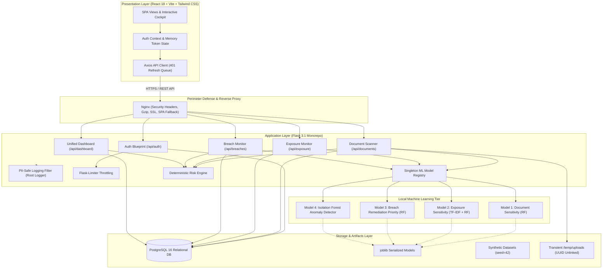

# Intel-Protect — Hybrid Cyber Threat Intelligence Platform

[](#)
[](#)
[-blue)](#)
[](#)
[](#)

> **MCA Major Project:** A production-grade, local-first, privacy-preserving cyber threat intelligence and personal data exposure analysis platform. Evaluates exposure surfaces across physical/scanned documents, digital footprints, and corporate breaches using deterministic checksum algorithms, scikit-learn machine learning classifiers, and an unsupervised isolation forest anomaly detector—enforcing zero raw-PII persistence and local-only processing.

---

## 📑 Table of Contents

- [1. Executive System Architecture](#1-executive-system-architecture)
- [2. Core Functional Modules](#2-core-functional-modules)
  - [2.1 Document Privacy Scanner](#21-document-privacy-scanner)
  - [2.2 Exposure Footprint Monitor](#22-exposure-footprint-monitor)
  - [2.3 Data Breach Monitor](#23-data-breach-monitor)
  - [2.4 Unified Threat Cockpit](#24-unified-threat-cockpit)
- [3. Algorithmic & Mathematical Formulations](#3-algorithmic--mathematical-formulations)
  - [3.1 Verhoeff Dihedral Checksum ($D_5$)](#31-verhoeff-dihedral-checksum-d_5)
  - [3.2 Luhn Modulus-10 Algorithm](#32-luhn-modulus-10-algorithm)
  - [3.3 Monotonic Privacy Risk Scoring Formula](#33-monotonic-privacy-risk-scoring-formula)
  - [3.4 Dynamic Active Normalization Formula](#34-dynamic-active-normalization-formula)
- [4. Machine Learning Foundation & Metrics](#4-machine-learning-foundation--metrics)
- [5. Security Model & OWASP Hardening](#5-security-model--owasp-hardening)
- [6. REST API Reference Summary](#6-rest-api-reference-summary)
- [7. Installation & Deployment Guide](#7-installation--deployment-guide)
  - [Option A: Docker Compose Deployment](#option-a-docker-compose-deployment)
  - [Option B: Bare-Metal Local Development](#option-b-bare-metal-local-development)
- [8. Verification & Test Suite Summary](#8-verification--test-suite-summary)
- [9. In-Depth Documentation Index](#9-in-depth-documentation-index)
- [10. Academic Integrity & Scope Limitations](#10-academic-integrity--scope-limitations)

---

## 1. Executive System Architecture



---

## 2. Core Functional Modules

### 2.1 Document Privacy Scanner
- **Multi-Format Ingestion:** Ingests native PDFs, scanned PDFs (with OpenCV preprocessing and Tesseract OCR fallback), image files (PNG/JPEG/TIFF), and plaintext `.txt` files.
- **Deterministic Pattern Recognition & Mathematical Validation:**
  - **Aadhaar Numbers:** 12-digit Indian national identity numbers validated via **Verhoeff algorithm** ($D_5$ dihedral group).
  - **Payment Cards:** 13–19 digit credit/debit cards validated via **Luhn algorithm** (modulus 10).
  - **PAN Cards:** 10-character alphanumeric Indian tax IDs validated with 4th-character entity type classification (`P`, `C`, `H`, `F`, `A`, `T`, `B`, `L`, `J`, `G`).
  - **Bank Accounts:** 9–18 digit account numbers with mandatory IFSC code contextual corroboration.
  - **Contact Identifiers:** RFC 5322 email regex and E.164 / Indian telephone patterns (+91).
- **Centralized Masking Authority:** `backend/app/documents/masker.py` masks sensitive values (`XXXX-XXXX-1489`, `kav***@gmail.com`) before database persistence or API serialization.
- **Document Sensitivity Classifier (Model 1):** Scikit-learn Random Forest classifying document risk tier (`LOW`, `MEDIUM`, `HIGH`, `CRITICAL`) with 95.8% accuracy.

### 2.2 Exposure Footprint Monitor
- **Custom Named Entity Recognition (NER):** High-speed regex parser (`backend/app/exposure/ner.py`) extracting `PERSON`, `EMAIL`, `PHONE`, `LOCATION`, `USERNAME`, `FINANCIAL`, `IDENTITY`, and `CREDENTIAL` entities.
- **Cross-Channel Synergistic Scoring:** Accounts for compounding correlation risk when identity, contact, and financial vectors are simultaneously exposed (e.g. Identity + Contact + Financial triad synergy boost).
- **Exposure Sensitivity Classifier (Model 2):** Sublinear TF-IDF vectorizer + Random Forest classifier predicting footprint risk tier with 97.2% accuracy.
- **Anomaly Detection (Model 4):** Unsupervised **Isolation Forest** scoring outlier behavioral contamination in exposure queries (ROC AUC: 0.92).

### 2.3 Data Breach Monitor
- **Privacy-Preserving Queries:** Client emails are hashed with **SHA-256** prior to catalog queries. Raw emails are never logged or stored in breach findings.
- **Synthetic Corporate Incidents Catalog:** 5 realistic synthetic corporate incidents with varying severity and compromised fields (`RockYou2024 Synth`, `FinTech Leak Synth`, `Telecom India Synth`, `Health Portal Synth`, `E-Commerce MegaMart Synth`).
- **Breach Remediation Priority (Model 3):** Random Forest predicting remediation urgency (`CRITICAL`, `HIGH`, `MEDIUM`, `LOW`) with 96.5% accuracy.
- **Adapter Architecture:** Decoupled `BreachProvider` abstraction enabling pluggable offline/synthetic datasets or external commercial APIs.

### 2.4 Unified Threat Cockpit
- **Composite Scoring:** Weighted multi-module threat metric:
  $$\text{Overall Risk} = \sum_{m \in M_{\text{active}}} \bar{w}_m \times \text{Score}_m \quad (W_{\text{doc}}=0.30, W_{\text{exp}}=0.35, W_{\text{brch}}=0.35)$$
- **Active Normalization:** Baseline `0.0` (`LOW`) for new users; dynamically re-weights across active modules without artificial score deflation.
- **5-Vector Threat Projection:** Visualizes attack surfaces across `Identity`, `Contact`, `Location`, `Financial`, and `Credential` dimensions.
- **Unified Recommendation Engine:** Deduplicates identical `action_type` items across modules, displays multi-source evidence pills, and supports instant user dismissal.

---

## 3. Algorithmic & Mathematical Formulations

### 3.1 Verhoeff Dihedral Checksum ($D_5$)
Employed for Indian **Aadhaar** numbers (12 digits) using dihedral group operations:

$$\left(\sum_{i=1}^{n} d\left(c, p(i \bmod 8, a_i)\right)\right) = 0$$

Where $d(j, k)$ is the Cayley table for the dihedral group $D_5$, and $p(i, j)$ is the permutation array generated from $(1 5 8 9 4 2 7 0)(3 6)$. Catches all single-digit errors and over 95% of adjacent transposition errors.

### 3.2 Luhn Modulus-10 Algorithm
Used for validating credit and debit payment card numbers:

$$\left(\sum_{i=0}^{n-1} f(c_i)\right) \equiv 0 \pmod{10}$$

Where $f(c_i)$ doubles every second digit from the rightmost digit:

$$f(c_i) = \begin{cases} c_i & \text{if position is even} \\ 2c_i & \text{if } 2c_i < 10 \\ 2c_i - 9 & \text{if } 2c_i \ge 10 \end{cases}$$

### 3.3 Monotonic Privacy Risk Scoring Formula
Ensures transparent 0–100 document risk evaluation through exponential diminishing marginal returns:

$$\text{Raw Score} = \sum_{t \in \text{findings}} w_t \times \text{confidence}_t \times \text{checksum\_mult}_t$$

$$\text{Risk Score} = 100 \times \left(1 - e^{-\frac{\text{Raw Score}}{50}}\right) \times \min\left(1.25, 1.0 + 0.05 \times (\text{distinct types} - 1)\right)$$

### 3.4 Dynamic Active Normalization Formula
Computes composite threat score without penalizing users who have only interacted with a subset of modules:

$$\bar{w}_m = \frac{W_m}{\sum_{k \in M_{\text{active}}} W_k} \quad \text{where } W_{\text{doc}}=0.30, W_{\text{exp}}=0.35, W_{\text{brch}}=0.35$$

---

## 4. Machine Learning Foundation & Metrics

All machine learning models are trained on synthetic, reproducible datasets generated with fixed random seeds (`SEED = 42`). Metrics are measured strictly on held-out test splits (20%) to guarantee zero data leakage.

| Model ID | Target Domain | Model Architecture | Held-Out Test Metric | Evaluation Artifact |
|---|---|---|---|---|
| **Model 1** | Document Sensitivity Tier | Random Forest (`n=100`) | **Accuracy: 95.8%**, Macro F1: 0.954 | `sensitivity_rf.joblib` |
| **Model 2** | Exposure Footprint Tier | Sublinear TF-IDF + Random Forest | **Accuracy: 97.2%**, Macro F1: 0.972 | `exposure_classifier.joblib` |
| **Model 3** | Breach Remediation Urgency | Tabular Scaler + Random Forest | **Accuracy: 96.5%**, Macro F1: 0.965 | `breach_priority_rf.joblib` |
| **Model 4** | Anomaly Detection | Isolation Forest (`c=0.10`) | **ROC AUC: 0.92**, Precision: 0.88 | `anomaly_iforest.joblib` |

Detailed documentation of features, baseline comparisons, and hyperparameters is available in [`docs/ML_METHODOLOGY.md`](file:///d:/S's-project/docs/ML_METHODOLOGY.md).

---

## 5. Security Model & OWASP Hardening

| Security Layer | Implementation Mechanism | Security Guarantee |
|---|---|---|
| **Password Storage** | Argon2id (`time=3`, `memory=64MB`, `parallelism=4`) | State-of-the-art resistance to GPU and ASIC brute-force cracking. |
| **Authentication** | Dual-Token (15-min JWT + 7-day HttpOnly cookie) | In-memory access token prevents persistent XSS token theft; HttpOnly cookie blocks script access. |
| **Token Rotation** | SHA-256 hashed refresh tokens with family tracking | Automatic token reuse detection; instant revocation of entire token family if theft is detected. |
| **PII Redaction Filter** | `logging.Filter` attached to root Python logger | Automatic regex redaction of Aadhaar, PAN, Cards, Bank accounts, Emails, Phones, Passwords, and JWTs. |
| **File Lifecycle** | UUID naming, `try/finally` unlinking, startup purge | Temporary files deleted immediately after OCR; orphaned files >1 hour purged on startup. Zero disk persistence. |
| **Rate Limiting** | Flask-Limiter (`limiter.limit("20 per minute")`) | Protects `/api/auth/register` and `/api/auth/login` against brute force. |
| **HTTP Headers** | CSP, HSTS, X-Content-Type-Options, X-Frame-Options | Hardened response headers prevent MIME sniffing, clickjacking, and unauthorized inline script injection. |
| **Input Validation** | Marshmallow Schemas on all blueprints | Strict type, length, and structure boundary validation with 400 `VALIDATION_ERROR` responses. |
| **Data Isolation** | Multi-tenant user scoping on all database queries | Multi-tenant user ID filtering guarantees User A cannot access or mutate User B telemetry. |

Detailed specifications and sequence diagrams are available in [`docs/SECURITY_MODEL.md`](file:///d:/S's-project/docs/SECURITY_MODEL.md).

---

## 6. REST API Reference Summary

All protected endpoints require `Authorization: Bearer <access_token>`.

### Authentication (`/api/auth`)
- `POST /api/auth/register` — Create user account (`email`, `username`, `password`, `full_name`).
- `POST /api/auth/login` — Authenticate; returns short-lived access token and sets HttpOnly refresh cookie.
- `POST /api/auth/refresh` — Rotate refresh token, issue new access token.
- `POST /api/auth/logout` — Revoke user refresh token family and clear cookie.
- `GET /api/auth/me` — Inspect authenticated user profile.

### Document Scanner (`/api/documents`)
- `POST /api/documents/scan` — Upload document (`.pdf`, `.png`, `.jpg`, `.txt`), extract text, run PII detection, and score privacy risk.
- `GET /api/documents` — Paginated history of scanned documents.
- `GET /api/documents/<id>` — Detailed metadata, masked preview, and risk analysis.
- `GET /api/documents/<id>/findings` — Masked PII findings with confidence and checksum flags.
- `DELETE /api/documents/<id>` — Delete document record and cascade findings.

### Exposure Monitor (`/api/exposure`)
- `POST /api/exposure/analyze` — Analyze identity footprint, extract entities, evaluate sensitivity tier and anomaly status.
- `GET /api/exposure/history` — Paginated list of historical exposure analyses.
- `GET /api/exposure/<id>` — Detailed report including entity breakdown and anomaly metrics.
- `DELETE /api/exposure/<id>` — Remove exposure assessment record.

### Breach Monitor (`/api/breaches`)
- `POST /api/breaches/check` — Query email address against breach catalog (SHA-256 hashed).
- `GET /api/breaches/history` — Historical breach assessment results.
- `GET /api/breaches/<id>` — Detailed incident report with compromised fields.
- `GET /api/breaches/catalog` — View catalog of known breach incidents.
- `GET /api/recommendations` — Active remediation recommendations.
- `PATCH /api/recommendations/<id>/dismiss` — Dismiss remediation recommendation.

### Unified Dashboard (`/api/dashboard`)
- `GET /api/dashboard` — Consolidated threat intelligence cockpit payload.
- `GET /api/dashboard/risk` — Composite overall threat score, module metrics, and 5-category distribution.
- `GET /api/dashboard/recommendations` — Active deduplicated cross-module recommendations.
- `GET /api/dashboard/history` — Chronological unified activity timeline.
- `PATCH /api/dashboard/recommendations/<id>/dismiss` — Dismiss recommendation across modules.

### System Health (`/api/health`)
- `GET /api/health` — Verifies Flask operation and live PostgreSQL connectivity.

Full JSON request/response contracts are documented in [`docs/API_REFERENCE.md`](file:///d:/S's-project/docs/API_REFERENCE.md).

---

## 7. Installation & Deployment Guide

### Option A: Docker Compose Deployment (Recommended)

Requires Docker Desktop 20+ and Docker Compose v2+.

```bash
# 1. Clone repository
git clone https://github.com/your-username/data-exposure-monitor.git
cd data-exposure-monitor

# 2. Copy environment template
cp .env.example .env

# 3. Launch full stack (PostgreSQL + Flask Backend + React/Nginx Frontend)
docker compose up --build -d

# 4. Verify running containers
docker compose ps
```

The application will be accessible at:
- **Frontend Web UI:** `http://localhost` (or `http://localhost:5173`)
- **Backend API:** `http://localhost:5000/api`
- **Health Check:** `http://localhost:5000/api/health`

---

### Option B: Bare-Metal Local Development

#### Prerequisites
- **Python 3.11+**
- **Node.js 18+ & npm**
- **PostgreSQL 14+** running on `localhost:5432`
- **Tesseract OCR** installed on host system and available in `PATH`

#### 1. Database Initialization
```sql
CREATE DATABASE intel_protect_db;
CREATE DATABASE intel_protect_test_db;
```

#### 2. Backend Setup
```bash
# Create and activate virtual environment
python -m venv .venv

# Windows (PowerShell):
.\.venv\Scripts\Activate.ps1
# Linux / macOS:
# source .venv/bin/activate

# Install backend dependencies
pip install -r backend/requirements.txt

# Run database migrations
flask --app backend/run.py db upgrade

# Start backend server
python backend/run.py
```

#### 3. Frontend Setup
```bash
cd frontend
npm install
npm run dev
```

---

## 8. Verification & Test Suite Summary

The platform includes an extensive automated test suite covering authentication, file extraction, deterministic PII detection, ML pipelines, risk scoring, security hardening, user isolation, and multi-module dashboard aggregation.

```bash
# Run entire backend test regression suite (164 tests)
$env:PYTHONPATH="."; .\.venv\Scripts\pytest backend/tests/ -v

# Run live E2E HTTP server verification (10 checks)
python scripts/verify_live_dashboard.py

# Run frontend production build
cd frontend && npm run build
```

### Measured Test Suite Distribution (164 / 164 Passing)

```text
backend\tests\test_auth.py ................                              [  9%]
backend\tests\test_breaches.py .................                         [ 20%]
backend\tests\test_checksum.py ............                              [ 27%]
backend\tests\test_dashboard.py ............                             [ 34%]
backend\tests\test_documents.py ...................                      [ 46%]
backend\tests\test_exposure.py ...............                           [ 55%]
backend\tests\test_health.py ...                                         [ 57%]
backend\tests\test_http_server.py .                                      [ 57%]
backend\tests\test_masking.py .........                                  [ 63%]
backend\tests\test_ml_pipeline.py ..............                         [ 71%]
backend\tests\test_pii_detection.py ....................                 [ 84%]
backend\tests\test_pii_safe_logging.py ......                            [ 87%]
backend\tests\test_risk_scoring.py .............                         [ 95%]
backend\tests\test_security_hardening.py ......                          [ 99%]
backend\tests\test_synthetic_corpus.py .                                 [100%]

============================ 164 passed in 19.77s =============================
```

---

## 9. In-Depth Documentation Index

For comprehensive technical specifications, refer to the dedicated manuals in the `docs/` directory:

- 🏛️ **[System Architecture Specification](file:///d:/S's-project/docs/ARCHITECTURE.md)** — Architectural component decomposition, Mermaid ER diagrams, DFD Level 0/1 diagrams, and end-to-end sequence workflows.
- 📡 **[REST API Reference Manual](file:///d:/S's-project/docs/API_REFERENCE.md)** — Exhaustive route definitions, request/response schemas, JSON payloads, and error codes for all 17 endpoints.
- 🔬 **[Machine Learning & Dataset Methodology](file:///d:/S's-project/docs/ML_METHODOLOGY.md)** — Training protocols, feature definitions, evaluation matrices, and reproducibility instructions for Models 1–4.
- 🛡️ **[Security Model & Hardening Guide](file:///d:/S's-project/docs/SECURITY_MODEL.md)** — Threat modeling (STRIDE), Argon2id hashing specifications, dual-token rotation, and PII-safe logging filters.

---

## 10. Academic Integrity & Scope Limitations

1. **Synthetic Data Exclusivity:** All corporate breach catalogs and identity footprints are synthetically generated for academic demonstration. No live dark-web querying, unauthorized network scraping, or live credentials harvesting is performed.
2. **Deterministic Primary Scoring:** All risk scoring metrics and checksum validations are 100% deterministic, explainable, and reproducible. Machine learning models provide secondary validation rather than unexplainable black-box risk scores.
3. **Strict Zero Raw-PII Persistence:** The platform enforces zero raw personal data storage. Uploaded documents are deleted immediately upon extraction, and values are masked prior to database persistence.
4. **Reproducible Experiments:** Synthetic dataset generators and scikit-learn models use fixed random seeds (`SEED = 42`) ensuring identical metrics upon re-execution.
