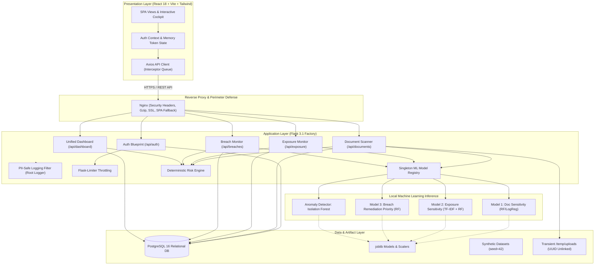
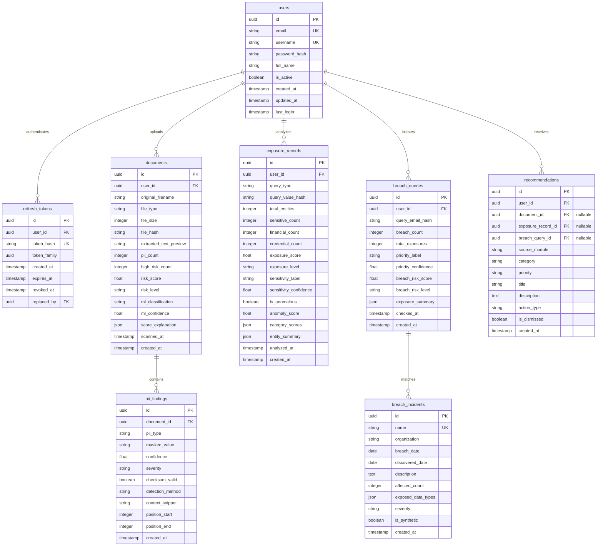
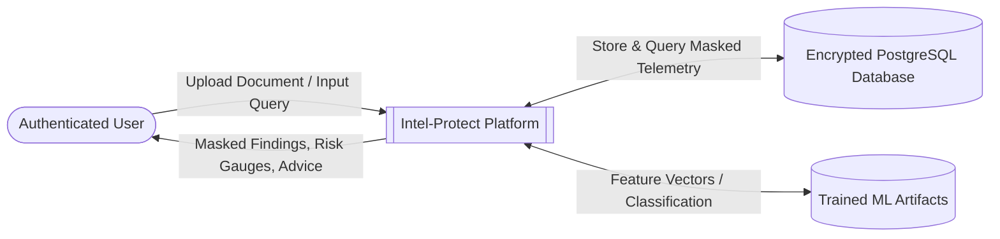
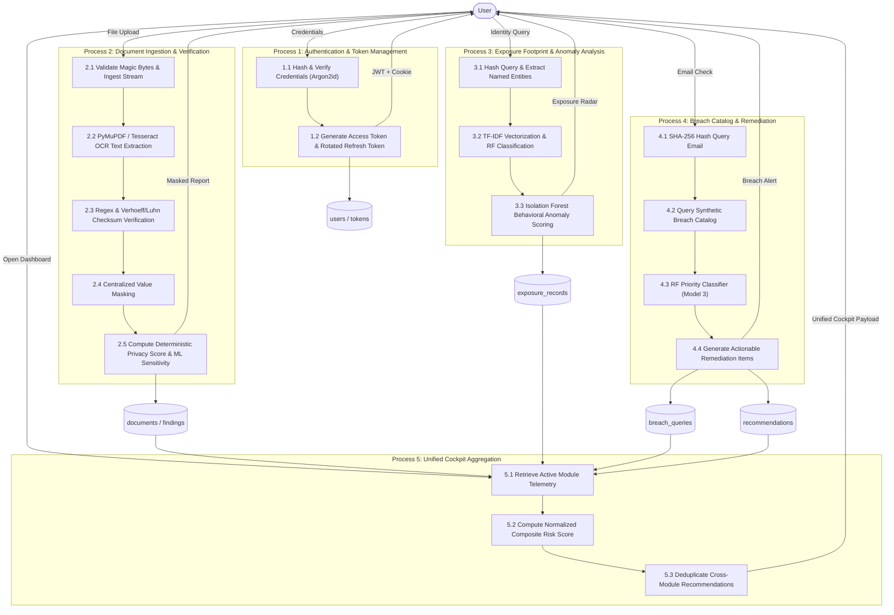
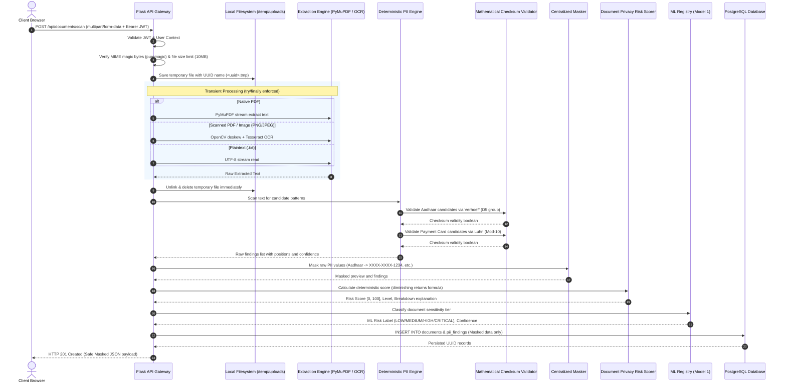
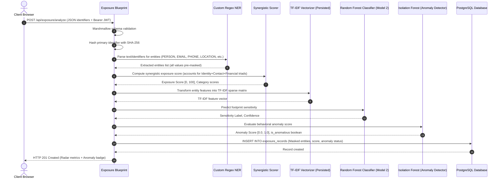

# Intel-Protect — System Architecture Documentation

**Document Version:** 1.0.0  
**Project:** Intel-Protect — Hybrid Cyber Threat Intelligence Platform (MCA Major Project)  
**Classification:** Technical Architecture Specification  
**Status:** Implemented & Verified  

---

## 1. Architectural Overview

**Intel-Protect** is engineered as a privacy-preserving, local-first cyber threat intelligence platform. The architecture decomposes threat surface analysis into three independent functional assessment engines—**Document Privacy Scanner**, **Exposure Footprint Monitor**, and **Data Breach Monitor**—which converge into a centralized **Unified Threat Dashboard**.

The system strictly enforces a **Zero Raw-PII Storage Policy**: sensitive data ingested through physical or digital documents, search parameters, or breach lookups are either processed in transient memory and unlinked immediately, or transformed via mathematical checksums, cryptographic hashes (SHA-256), and centralized masking before persistence.

---

## 2. Subsystem Boundaries & Responsibilities

| Subsystem | Architectural Role | Core Technical Stack | Persisted Data Invariant |
|---|---|---|---|
| **Authentication & Session** | Issues short-lived access JWTs and manages HttpOnly refresh token rotation with family revocation on reuse. | Argon2id, PyJWT, Flask-Limiter | No plaintext passwords; only Argon2id hash. Refresh tokens hashed via SHA-256. |
| **Document Scanner** | Extracts text from native/scanned PDFs and images, runs deterministic PII detection, validates checksums, computes 0–100 risk score, and executes Model 1 classification. | PyMuPDF, Tesseract OCR, OpenCV, Verhoeff $D_5$, Luhn Mod-10 | Raw uploaded files deleted immediately via `try/finally`. Only masked text preview (`XXXX-1234`) and findings persisted. |
| **Exposure Monitor** | Ingests identity footprint queries, extracts named entities via custom regex NER, classifies footprint sensitivity via TF-IDF + Random Forest, and detects behavioral anomalies via Isolation Forest. | Custom NER, Scikit-learn TF-IDF, Random Forest, Isolation Forest | Query identifiers converted to SHA-256 hash. Entity values stored only as masked strings. |
| **Breach Monitor** | Queries email addresses against local synthetic corporate incident catalogs using SHA-256 hashes, classifies remediation priority via Model 3, and generates actionable advice. | Pluggable `BreachProvider` Adapter, Random Forest Classifier | Query email stored exclusively as SHA-256 hex digest. No live network scraping. |
| **Unified Dashboard** | Synthesizes scores from all 3 modules into a single 0–100 composite threat score with dynamic active-module normalization, projects risk onto 5 threat vectors, and deduplicates recommendations. | Deterministic Composite Scorer, Recharts Radar/Area/Bar | Aggregated dynamically across user-isolated tables. Zero cross-tenant data leaks. |

---

## 3. Database Architecture (Entity-Relationship Model)

The database schema is managed via **Flask-Migrate (Alembic)** and enforced with strict foreign-key cascades and unique indexes.

### 3.1 Mermaid ER Diagram

### 3.2 Relational Performance Indexes

| Table | Index Columns | Type | Purpose |
|---|---|---|---|
| `users` | `email` | UNIQUE B-Tree | O(1) login lookup |
| `users` | `username` | UNIQUE B-Tree | O(1) username availability check |
| `refresh_tokens` | `token_hash` | UNIQUE B-Tree | Fast token rotation verification |
| `refresh_tokens` | `(token_family, revoked_at)` | Composite B-Tree | Immediate token family revocation upon reuse theft |
| `documents` | `(user_id, created_at DESC)` | Composite B-Tree | Fast user-isolated document history pagination |
| `pii_findings` | `document_id` | B-Tree | Rapid retrieval of findings for a given document |
| `exposure_records` | `(user_id, created_at DESC)` | Composite B-Tree | Fast user-isolated exposure audit history pagination |
| `breach_queries` | `(user_id, created_at DESC)` | Composite B-Tree | Fast user-isolated breach query history |
| `recommendations` | `(user_id, is_dismissed, created_at DESC)` | Composite B-Tree | Instant filtering of active recommendations for dashboard |

---

## 4. Data Flow Diagrams (DFD)

### 4.1 DFD Level 0 — System Context Diagram

### 4.2 DFD Level 1 — Decomposed Operational Flow

---

## 5. End-to-End Sequence Diagrams

### 5.1 Document Ingestion & Mathematical Checksum Verification

### 5.2 Exposure Analysis & Anomaly Detection Sequence

---

## 6. Algorithmic & Mathematical Formulations

### 6.1 Verhoeff Dihedral Group ($D_5$) Checksum Algorithm
Used to validate 12-digit Indian **Aadhaar** numbers without false-positive identification. It operates on permutations of the dihedral group $D_5$ of order 10:

$$\left(\sum_{i=1}^{n} d\left(c, p(i \bmod 8, a_i)\right)\right) = 0$$

Where:
- $d(j, k)$ is the non-commutative group operation table for $D_5$.
- $p(i, j)$ is the permutation table based on the permutation $(1 5 8 9 4 2 7 0)(3 6)$.
- $c$ is the check digit appended such that the total multiplication equals the identity element $0$.

### 6.2 Luhn Modulus 10 Algorithm
Used to validate 13–19 digit **Credit/Debit Payment Cards**:

$$\left(\sum_{i=0}^{n-1} f(c_i)\right) \equiv 0 \pmod{10}$$

Where $f(c_i)$ doubles every second digit from the rightmost digit:

$$f(c_i) = \begin{cases} c_i & \text{if position is even} \\ 2c_i & \text{if } 2c_i < 10 \\ 2c_i - 9 & \text{if } 2c_i \ge 10 \end{cases}$$

### 6.3 Deterministic Privacy Risk Monotonic Saturation Formula
Document privacy risk is computed using an exponential diminishing-returns saturation model to ensure monotonicity, transparency, and strict bounding in $[0, 100]$:

$$\text{Raw Score} = \sum_{t \in \text{findings}} w_t \times \text{confidence}_t \times \text{checksum\_mult}_t$$

$$\text{Risk Score} = 100 \times \left(1 - e^{-\frac{\text{Raw Score}}{K}}\right) \times \text{Diversity Multiplier}$$

Where:
- $w_t \in \{10, 20, 30, 40\}$ represents severity weight (`LOW`, `MEDIUM`, `HIGH`, `CRITICAL`).
- $\text{checksum\_mult} = 1.0$ for structurally validated numbers, $0.5$ for structurally unverified.
- $K = 50$ is the saturation scaling constant.
- $\text{Diversity Multiplier} = 1.0 + 0.05 \times (\text{distinct PII types} - 1)$, capped at $1.25$.

### 6.4 Unified Composite Risk Formula with Dynamic Active Normalization
The unified cockpit combines scores across Document ($D$), Exposure ($E$), and Breach ($B$) modules using an approved design formula:

$$\text{Base Weights:} \quad W_{\text{doc}} = 0.30, \quad W_{\text{exp}} = 0.35, \quad W_{\text{brch}} = 0.35$$

$$\text{Normalized Weight for active module } m: \quad \bar{w}_m = \frac{W_m}{\sum_{k \in M_{\text{active}}} W_k}$$

$$\text{Overall Threat Score} = \begin{cases} 0.0 & \text{if } M_{\text{active}} = \emptyset \\ \sum_{m \in M_{\text{active}}} \bar{w}_m \times \text{Score}_m & \text{otherwise} \end{cases}$$

This mathematical property guarantees that new users receive a baseline $0.0$ (`LOW`) score without artificial penalty, and partial users are evaluated purely on the data they have provided.
