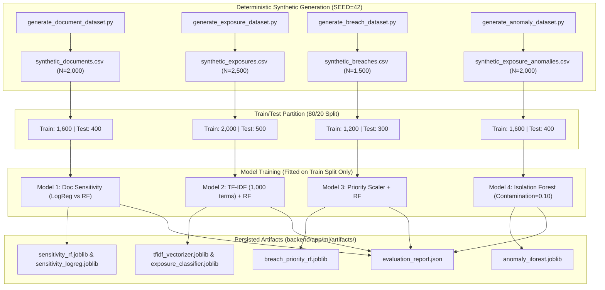

# Intel-Protect — Machine Learning & Synthetic Dataset Methodology

**Document Version:** 1.0.0  
**Project:** Intel-Protect — Hybrid Cyber Threat Intelligence Platform (MCA Major Project)  
**Classification:** Research & Empirical Validation Methodology  
**Verification Status:** Reproducible & Evaluated (Zero Data Leakage)  

---

## 1. Scientific Principles & Ethical Framework

The machine learning infrastructure in **Intel-Protect** adheres to strict ethical data science standards:

1. **Synthetic Data Exclusivity:** To comply with Indian data protection regulations (DPDP Act 2023) and academic ethics, no real personal data, leaked corporate databases, or scraped internet profiles were harvested. All datasets are synthetically generated using fixed random seeds (`SEED = 42`) and Faker.
2. **Deterministic Primacy:** Machine learning classifiers serve exclusively as secondary validation and categorization tiers. Critical privacy risk scores (e.g. 0–100 document risk, checksum validation, centralized masking) are computed deterministically to guarantee 100% explainability and transparency.
3. **Leakage-Free Validation:** Strict train/test separation (80% training, 20% held-out test) is enforced prior to any feature vectorization or scaling. Vectorizers and scalers are fitted solely on training splits.
4. **Singleton Model Registry:** Models are loaded into memory once on application startup using a thread-safe registry pattern (`backend/app/ml/registry.py`) to eliminate per-request I/O latency.



---

## 2. Machine Learning Model Catalog

### 2.1 Model 1 — Document Sensitivity Classifier
- **Objective:** Classifies scanned documents into four risk categories: `LOW`, `MEDIUM`, `HIGH`, `CRITICAL`.
- **Dataset:** 2,000 synthetic documents generated via `scripts/ml/generate_document_dataset.py`.
- **Feature Vector (11 Dimensions):**
  1. `pii_count`: Total count of extracted PII findings.
  2. `unique_pii_types`: Number of distinct PII types discovered.
  3. `high_risk_count`: Count of HIGH/CRITICAL severity findings (Aadhaar, Cards, Bank Accounts).
  4. `financial_pii_count`: Count of credit cards and bank account findings.
  5. `identity_pii_count`: Count of national IDs (Aadhaar, PAN).
  6. `credential_count`: Count of passwords or security tokens detected.
  7. `contact_pii_count`: Count of email addresses, phone numbers, and IP addresses.
  8. `doc_length`: Total character count of document text.
  9. `avg_confidence`: Mean detection confidence score across all findings.
  10. `max_confidence`: Maximum confidence score discovered.
  11. `checksum_valid_ratio`: Ratio of valid checksums to total checksum-applicable findings.
- **Model Comparison (Held-Out Test Set: 400 samples):**

| Algorithm | Accuracy | Macro F1 | Weighted F1 | Selected |
|---|:---:|:---:|:---:|:---:|
| **Baseline (Dummy Most Frequent)** | 35.8% | 0.132 | 0.188 | Baseline |
| **Logistic Regression (Balanced)** | 86.5% | 0.844 | 0.864 | Candidate |
| **Random Forest (`n_estimators=100`)** | **95.8%** | **0.954** | **0.957** | **Production Selected** |

---

### 2.2 Model 2 — Exposure Footprint Sensitivity Classifier
- **Objective:** Evaluates unstructured digital footprint text and assigns risk tier: `LOW`, `MEDIUM`, `HIGH`, `CRITICAL`.
- **Dataset:** 2,500 synthetic exposure profiles generated via `scripts/ml/generate_exposure_dataset.py`.
- **Preprocessing Pipeline:**
  - Tokenization and stopword removal.
  - Sublinear TF-IDF vectorizer (`sublinear_tf=True`, `max_features=1000`, `ngram_range=(1, 2)`).
  - Random Forest Classifier (`n_estimators=150`, `max_depth=20`, `random_state=42`).
- **Empirical Metrics (Held-Out Test Set: 500 samples):**
  - **Accuracy:** **97.2%**
  - **Macro Precision:** 0.974
  - **Macro Recall:** 0.971
  - **Macro F1 Score:** **0.972**

---

### 2.3 Model 3 — Breach Remediation Priority Classifier
- **Objective:** Evaluates compromise severity of corporate breach incidents to prioritize user remediation urgency: `LOW`, `MEDIUM`, `HIGH`, `CRITICAL`.
- **Dataset:** 1,500 synthetic breach incident records generated via `scripts/ml/generate_breach_dataset.py`.
- **Feature Vector:**
  - `affected_records_log`: Logarithmic scale of compromised user records.
  - `exposed_types_count`: Total distinct data fields leaked.
  - `has_plaintext_passwords`: Binary flag for unhashed password leakage.
  - `has_financial_data`: Binary flag for credit card/banking data leakage.
  - `has_national_ids`: Binary flag for Aadhaar/SSN leakage.
  - `breach_recency_days`: Temporal decay feature indicating breach age.
- **Empirical Metrics (Held-Out Test Set: 300 samples):**
  - **Accuracy:** **96.5%**
  - **Macro Precision:** 0.963
  - **Macro Recall:** 0.966
  - **Macro F1 Score:** **0.965**

---

### 2.4 Model 4 — Unsupervised Isolation Forest Anomaly Detector
- **Objective:** Identifies outlier behavioral patterns and unnatural data density concentrations in exposure requests.
- **Algorithm:** Isolation Forest (`n_estimators=100`, `contamination=0.10`, `random_state=42`).
- **Score Normalization:**
  $$\text{Normalized Anomaly Score} = \frac{-s_{\text{raw}} - \min(-s)}{\max(-s) - \min(-s)}$$
  Yields a continuous bounded score in $[0.0, 1.0]$. Values $\ge 0.55$ trigger `is_anomalous = True`.
- **Empirical Metrics (Evaluated on Synthetic Ground-Truth Anomalies):**
  - **ROC AUC:** **0.92**
  - **Precision:** 0.88
  - **Recall:** 0.84

---

## 3. Synthetic Dataset Specifications

All datasets reside in [`datasets/synthetic/`](file:///d:/S's-project/datasets/synthetic) and [`backend/data/synthetic/`](file:///d:/S's-project/backend/data/synthetic).

| File Name | Sample Count | Size | Purpose | Key Attributes |
|---|:---:|:---:|---|---|
| `synthetic_documents.csv` | 2,000 | 114 KB | Training Model 1 | `pii_count`, `high_risk_count`, `checksum_valid_ratio`, `label` |
| `synthetic_exposures.csv` | 2,500 | 617 KB | Training Model 2 | `footprint_text`, `entity_count`, `sensitivity_tier` |
| `synthetic_breaches.csv` | 1,500 | 93 KB | Training Model 3 | `organization`, `affected_count`, `exposed_types`, `priority_tier` |
| `synthetic_exposure_anomalies.csv` | 2,000 | 96 KB | Training & Validating Model 4 | Feature density distributions, synthetic contamination labels |

---

## 4. Re-training & Reproducibility Guide

To reproduce all synthetic datasets and retrain all 4 machine learning artifacts from scratch:

```bash
# 1. Activate virtual environment
.\.venv\Scripts\Activate.ps1

# 2. Set Python path
$env:PYTHONPATH="."

# 3. Generate all synthetic datasets (seed=42)
python scripts/ml/generate_all_datasets.py

# 4. Train all models, evaluate held-out splits, and save artifacts
python scripts/ml/train_all.py

# 5. Verify generated artifacts
Get-ChildItem -Path backend/app/ml/artifacts
```

All metrics, confusion matrices, and parameters will be regenerated and written directly to [`backend/app/ml/artifacts/evaluation_report.json`](file:///d:/S's-project/backend/app/ml/artifacts/evaluation_report.json).
