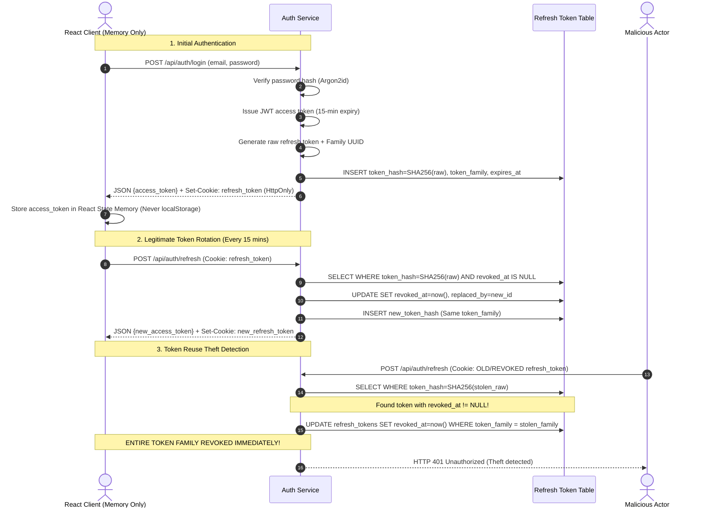
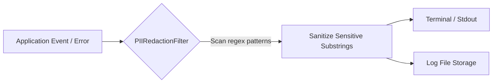

# Intel-Protect — Security Model & Hardening Specification

**Document Version:** 1.0.0  
**Project:** Intel-Protect — Hybrid Cyber Threat Intelligence Platform (MCA Major Project)  
**Classification:** Information Security Architecture Specification  
**Compliance Standard:** OWASP Top 10 & Privacy-by-Design  

---

## 1. Security Philosophy & Threat Model

**Intel-Protect** operates under the foundational premise that an analytical privacy tool must never become a privacy liability. If an attacker gains unauthorized access to the database or inspects server logs, they must find **zero actionable personal identifiers**.

### STRIDE Threat Analysis & Architectural Mitigations

| Threat Domain | Potential Attack Vector | Intel-Protect Defense-in-Depth Mitigation |
|---|---|---|
| **Spoofing** | Credential stuffing, brute forcing passwords, or forging identity claims. | Argon2id password hashing (`memory=64MB`), Flask-Limiter throttling (20 req/min on auth), cryptographically signed HS256 JWT access tokens. |
| **Tampering** | Parameter manipulation, document payload tampering, SQL injection. | Strict Marshmallow schemas rejecting unwhitelisted fields, SQLAlchemy parameterized queries, puremagic file magic byte validation. |
| **Repudiation** | Denying actions performed on audit logs or telemetry. | User-scoped audit history trails with immutable UTC timestamps and cryptographically hashed query digests (`query_value_hash`). |
| **Information Disclosure** | Leakage of PII in logs, server error traces, or API responses. | Centralized `PIIRedactionFilter` on root logger; centralized `mask_pii_value()` module; zero raw-PII persistence policy; try/finally file deletion. |
| **Denial of Service** | Uploading massive zip bombs or flooding endpoints. | 10 MB strict file size ceiling, Flask-Limiter endpoint quotas, PyMuPDF memory bounds, and Gunicorn request timeouts. |
| **Elevation of Privilege** | Cross-tenant access where User A accesses or dismisses User B's telemetry. | Mandatory `@jwt_required` decorator enforcing strict user ID scoping (`WHERE user_id = current_user_id`); returns HTTP 403 on mismatched requests. |

---

## 2. Authentication & Cryptographic Session Architecture



### 2.1 Password Hashing Parameters (Argon2id)
Password hashing utilizes the **Argon2id** hybrid mode according to OWASP guidelines:
- **Type:** Argon2id (`Type.ID`)
- **Time Cost (Iterations):** $3$
- **Memory Cost:** $65,536 \text{ KB}$ ($64 \text{ MB}$)
- **Parallelism (Threads):** $4$
- **Hash Length:** $32 \text{ bytes}$
- **Salt Length:** $16 \text{ bytes}$

### 2.2 Dual-Token Architecture & In-Memory Storage
1. **Access Token:** Short-lived (15 minutes), signed with `HS256`, containing minimal claims (`sub`, `email`, `iat`, `exp`, `jti`). Maintained purely in React memory state. **Never saved to `localStorage` or `sessionStorage`**, eliminating persistent XSS token theft vectors.
2. **Refresh Token:** Long-lived (7 days), stored in an `HttpOnly`, `SameSite=Strict` cookie (`Secure` enabled in production). The raw token is generated via `secrets.token_urlsafe(64)` and hashed with SHA-256 before storage in PostgreSQL.
3. **Automatic Theft Detection:** If an adversary captures and attempts to replay a previously rotated refresh token, the server identifies that a revoked token was submitted and triggers family-wide revocation, immediately terminating all sessions in that family.

---

## 3. PII Redaction Filter & Log Sanitization

Intel-Protect attaches a specialized `PIIRedactionFilter` (`backend/app/common/logging.py`) directly to Python's root logger during application startup:



### Redaction Rules Active on All Logger Records:
1. **JWTs & Bearer Headers:** `Bearer eyJ...` $\rightarrow$ `[REDACTED:JWT]`
2. **Passwords in JSON/Query:** `"password": "..."` $\rightarrow$ `"password": "[REDACTED:PASSWORD]"`
3. **Refresh Tokens:** `refresh_token=...` $\rightarrow$ `refresh_token=[REDACTED:REFRESH_TOKEN]`
4. **Credit/Debit Payment Cards:** Continuous or hyphenated 13–19 digits $\rightarrow$ `[REDACTED:CARD]`
5. **Aadhaar Numbers:** 12-digit Indian national identity numbers $\rightarrow$ `[REDACTED:AADHAAR]`
6. **PAN Numbers:** 10-char alphanumeric Indian tax IDs $\rightarrow$ `[REDACTED:PAN]`
7. **Email Addresses:** RFC 5322 matching emails $\rightarrow$ `[REDACTED:EMAIL]`
8. **Phone Numbers:** E.164 and Indian (+91) phone numbers $\rightarrow$ `[REDACTED:PHONE]`
9. **Bank Accounts:** Contextual numeric account patterns $\rightarrow$ `[REDACTED:BANK_ACCOUNT]`

---

## 4. Ephemeral File Lifecycle & Storage Security

Uploaded documents are processed transiently with strict deletion guarantees:

1. **Randomized UUID Filenames:** Uploaded files are written with cryptographically random UUID4 names (`/temp/uploads/<uuid>.tmp`) to prevent directory traversal or file-overwrite exploits.
2. **Deterministic Unlinking via `try/finally`:** Extraction pipelines execute within `try/finally` blocks ensuring `os.unlink()` is called even if OCR or PDF parsing raises an unexpected exception:
   ```python
   temp_path = TEMP_DIR / f"{uuid.uuid4().hex}.tmp"
   file_obj.save(temp_path)
   try:
       text = extract_text_from_file(temp_path, file_type)
       # ... PII detection & scoring ...
   finally:
       if temp_path.exists():
           temp_path.unlink()
   ```
3. **Startup Stale File Purge:** If the host server crashes mid-processing, orphaned temporary files could remain on disk. On application initialization, `cleanup_stale_temp_files(max_age_seconds=3600)` scans `/temp/uploads/` and deletes any file modified more than 1 hour ago.

---

## 5. HTTP Security Headers & Transport Security

All responses generated by Flask include hardened security headers:

| Header Name | Configured Value | Security Purpose |
|---|---|---|
| `X-Content-Type-Options` | `nosniff` | Prevents browser MIME-type sniffing. |
| `X-Frame-Options` | `DENY` | Prevents clickjacking by blocking iframe embedding. |
| `X-XSS-Protection` | `1; mode=block` | Activates legacy browser reflective XSS filter. |
| `Referrer-Policy` | `strict-origin-when-cross-origin` | Protects referrer privacy across external links. |
| `Permissions-Policy` | `geolocation=(), camera=(), microphone=()` | Disables device hardware access. |
| `Content-Security-Policy` | `default-src 'self'; script-src 'self'; ...` | Restricts script sources to local origin. |
| `Strict-Transport-Security` | `max-age=31536000; includeSubDomains` | Enforces HTTPS in production mode for 1 year. |

---

## 6. Input Validation & Rate Limiting

- **Marshmallow Schemas:** All request payloads (`Auth`, `Exposure`, `Breaches`) are strictly validated using Marshmallow schemas. Any unexpected fields, invalid data types, or out-of-range strings are rejected with HTTP 400 `VALIDATION_ERROR`.
- **Flask-Limiter:** Protects authentication endpoints against automated brute-force attacks:
  - Auth registration/login: 20 requests per minute per IP address.
  - Global API default: 1000 requests per day, 200 per hour.
