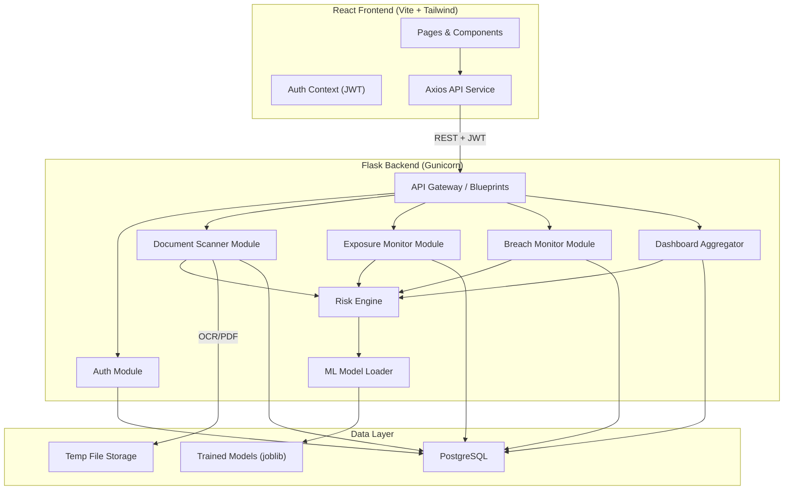
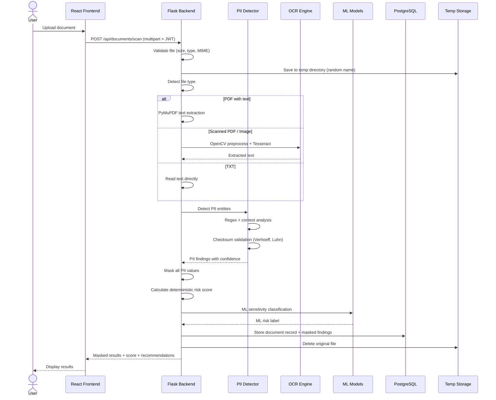
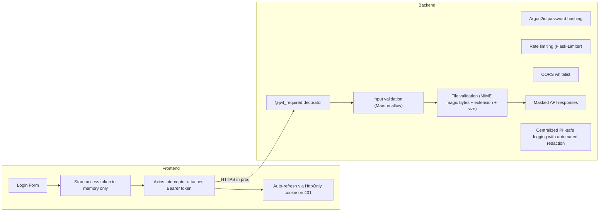
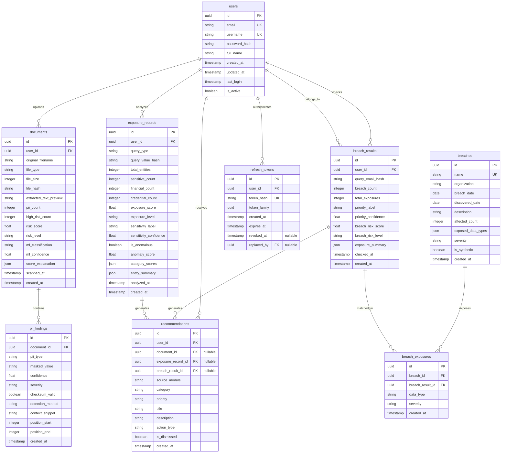
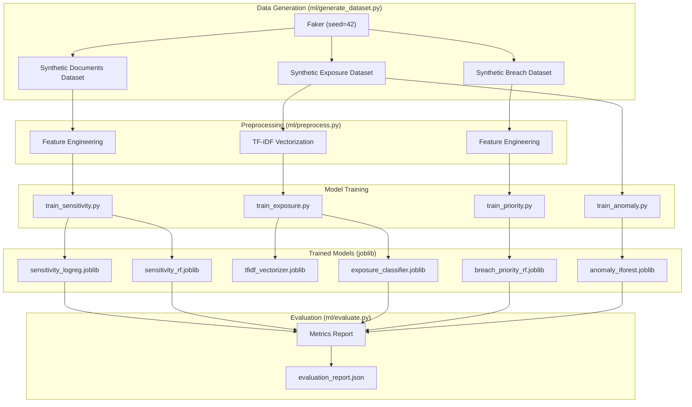

# Intel-Protect — Architecture & Planning Document

> **Data Exposure Monitor** — MCA Major Project  
> Version 1.0 · October 2026

---

## Table of Contents

1. [System Architecture](#1-system-architecture)
2. [Folder Structure](#2-folder-structure)
3. [Database ER Design](#3-database-er-design)
4. [API Architecture](#4-api-architecture)
5. [ML Pipeline](#5-ml-pipeline)
6. [Development Roadmap](#6-development-roadmap)
7. [Risks & Limitations](#7-risks--limitations)

---

## 1. System Architecture

### 1.1 High-Level Overview



### 1.2 Module Responsibilities

| Module | Responsibility |
|--------|---------------|
| **Auth** | Registration, login, JWT access/refresh tokens, password hashing (Argon2), user isolation |
| **Document Scanner** | File upload, validation, text extraction (PyMuPDF), OCR (Tesseract+OpenCV), PII detection, checksum validation (Verhoeff, Luhn), masking, risk scoring |
| **Exposure Monitor** | Custom NER (spaCy + regex), TF-IDF vectorization, Random Forest sensitivity classification, Isolation Forest anomaly detection, exposure scoring |
| **Breach Monitor** | Synthetic breach DB, email-based lookup, adapter pattern (Local/External providers), Random Forest priority model, recommendation engine |
| **Dashboard** | Aggregation of all module scores into unified privacy risk, per-category breakdowns, trend data |
| **Risk Engine** | Shared scoring logic, severity weights, normalization, explainability |
| **ML Model Loader** | Singleton loader for joblib-persisted models, lazy initialization |

### 1.3 Request Flow — Document Scan Example



### 1.4 Security Architecture



**Key security decisions:**
- JWT access tokens: **15-minute** expiry, stored in **frontend memory only** (not localStorage)
- Refresh tokens: **7-day** expiry, delivered as **HttpOnly cookie** (`Set-Cookie: refresh_token=...; HttpOnly; SameSite=Strict; Path=/api/auth`; `Secure` flag conditional on `FLASK_ENV != development`), **never returned in JSON response bodies**
- Refresh token storage: only a **SHA-256 hash** of the token is stored in the `refresh_tokens` table; the raw token is never persisted
- Passwords: **Argon2id** (preferred over bcrypt for memory-hardness)
- File uploads: **10 MB** max, MIME type validated by **reading file magic bytes** (not trusting `Content-Type` header)
- Temp files: UUID-named, deleted after processing via try/finally; orphaned files cleaned on startup
- No raw PII in logs, error messages, or API responses

#### 1.4.1 Refresh Token Rotation & Reuse Detection

```text
Login
  → issue access_token (JSON body) + refresh_token (HttpOnly cookie)
  → store SHA-256(refresh_token) in refresh_tokens table with a token_family UUID

Refresh request
  → read refresh_token from HttpOnly cookie
  → compute SHA-256(refresh_token), look up in refresh_tokens
  → if found, not revoked, and not expired:
      → revoke the old token (set revoked_at, set replaced_by → new token id)
      → issue new refresh_token (same token_family) → new HttpOnly cookie
      → issue new access_token → JSON body
  → if the token was already revoked/replaced:
      → ALERT: possible token theft
      → revoke ALL tokens in this token_family
      → respond 401, force re-login

Logout
  → revoke all refresh_tokens for this user
  → clear the HttpOnly cookie
```

This design ensures:
- A stolen refresh token can only be used once before the legitimate user's next refresh detects the theft
- The entire token family is revoked on reuse, limiting the blast radius
- Raw tokens never appear in the database — only hashes

#### 1.4.2 Temporary File Lifecycle & Crash Recovery

```text
Normal flow:
  Upload → save to temp dir (UUID name)
         → try:
              process (extract/OCR/PII detect)
           finally:
              delete temp file

Crash recovery:
  On application startup:
    → scan temp directory
    → delete all files older than 1 hour
  Background (optional):
    → periodic cleanup every 30 minutes for long-running servers
```

This ensures that even if the process crashes mid-OCR, orphaned files containing real PII are cleaned up on next startup.

#### 1.4.3 Centralized PII-Safe Logging

The application uses a **centralized log redaction mechanism** implemented as a custom Python `logging.Filter` (or formatter wrapper) that intercepts all log records before they reach any handler.

**Redacted patterns (at minimum):**

| Category | What is redacted |
|----------|-----------------|
| Identity documents | Aadhaar numbers, PAN numbers |
| Financial | Credit/debit card numbers, bank account numbers |
| Contact | Email addresses, phone numbers |
| Credentials | Passwords, password hashes, JWTs, refresh tokens |
| HTTP headers | `Authorization` header values |
| Request bodies | Fields named `password`, `email`, `phone`, `aadhaar`, `pan`, `card_number`, etc. |
| File content | Uploaded document contents, extracted text |

**Design:**
- The redaction filter is registered on the **root logger**, so it applies to all application loggers including Flask's and Werkzeug's
- Pattern matching uses the same regex patterns from the PII detector (shared, not duplicated)
- In production mode, Flask's default request logging (`werkzeug` logger) is suppressed or filtered through the redactor
- Request bodies containing user-submitted identifiers (`/api/exposure/analyze`, `/api/breaches/check`) are sanitized before any log entry
- The filter replaces matches with `[REDACTED:<TYPE>]` (e.g., `[REDACTED:AADHAAR]`, `[REDACTED:JWT]`)

**Testing requirement:** The test suite includes tests that pass representative sensitive values (Aadhaar, PAN, card numbers, emails, JWTs) through the logging system and assert that the redacted output contains no raw sensitive values.

---

## 2. Folder Structure

```
data-exposure-monitor/
│
├── backend/
│   ├── app/
│   │   ├── __init__.py              # Flask app factory
│   │   ├── config.py                # Environment-based configuration
│   │   │
│   │   ├── auth/
│   │   │   ├── __init__.py
│   │   │   ├── routes.py            # /api/auth/* endpoints
│   │   │   ├── service.py           # Business logic (register, login, refresh)
│   │   │   └── schemas.py           # Marshmallow validation schemas
│   │   │
│   │   ├── documents/
│   │   │   ├── __init__.py
│   │   │   ├── routes.py            # /api/documents/* endpoints
│   │   │   ├── service.py           # Orchestrates scan pipeline
│   │   │   ├── extractor.py         # PDF/TXT text extraction (PyMuPDF)
│   │   │   ├── ocr.py               # Tesseract + OpenCV preprocessing
│   │   │   ├── pii_detector.py      # Multi-pattern PII detection engine
│   │   │   ├── checksum.py          # Verhoeff (Aadhaar) + Luhn (Card)
│   │   │   ├── masker.py            # Centralized PII masking
│   │   │   └── scorer.py            # Deterministic 0-100 risk scoring
│   │   │
│   │   ├── exposure/
│   │   │   ├── __init__.py
│   │   │   ├── routes.py            # /api/exposure/* endpoints
│   │   │   ├── service.py           # Orchestrates exposure analysis
│   │   │   ├── ner.py               # Custom NER (spaCy + regex)
│   │   │   ├── classifier.py        # TF-IDF + Random Forest classifier
│   │   │   ├── anomaly.py           # Isolation Forest anomaly detection
│   │   │   └── scorer.py            # 0-100 exposure scoring
│   │   │
│   │   ├── breaches/
│   │   │   ├── __init__.py
│   │   │   ├── routes.py            # /api/breaches/* endpoints
│   │   │   ├── service.py           # Orchestrates breach checking
│   │   │   ├── repository.py        # Adapter pattern (Local/External providers)
│   │   │   ├── priority.py          # Random Forest priority model
│   │   │   └── recommendations.py   # Deterministic recommendation engine
│   │   │
│   │   ├── dashboard/
│   │   │   ├── __init__.py
│   │   │   ├── routes.py            # /api/dashboard endpoint
│   │   │   └── service.py           # Aggregation across all modules
│   │   │
│   │   ├── models/
│   │   │   ├── __init__.py          # Re-exports all models
│   │   │   ├── user.py
│   │   │   ├── refresh_token.py
│   │   │   ├── document.py
│   │   │   ├── pii_finding.py
│   │   │   ├── exposure_record.py
│   │   │   ├── breach.py
│   │   │   ├── breach_exposure.py
│   │   │   ├── breach_result.py
│   │   │   └── recommendation.py
│   │   │
│   │   └── common/
│   │       ├── __init__.py
│   │       ├── security.py          # Password hashing, token utils
│   │       ├── validators.py        # File validation, input sanitization
│   │       ├── logging.py           # Structured logging (PII-safe)
│   │       ├── errors.py            # Centralized error handlers
│   │       └── utils.py             # Shared utilities
│   │
│   ├── migrations/                  # Flask-Migrate (Alembic) migrations
│   │
│   ├── ml/
│   │   ├── generate_dataset.py      # Synthetic data generation (Faker, seed=42)
│   │   ├── preprocess.py            # Feature engineering & preprocessing
│   │   ├── train_sensitivity.py     # LogReg + RF for document sensitivity
│   │   ├── train_exposure.py        # TF-IDF + RF for exposure classification
│   │   ├── train_priority.py        # RF for breach priority
│   │   ├── train_anomaly.py         # Isolation Forest for anomaly detection
│   │   └── evaluate.py             # Unified evaluation (metrics + reports)
│   │
│   ├── datasets/
│   │   └── synthetic/               # Generated CSV/JSON datasets
│   │
│   ├── trained_models/              # joblib-persisted models
│   │
│   ├── tests/
│   │   ├── conftest.py              # Fixtures (test client, test DB, auth)
│   │   ├── test_auth.py
│   │   ├── test_pii_detection.py
│   │   ├── test_checksum.py
│   │   ├── test_masking.py
│   │   ├── test_scoring.py
│   │   ├── test_documents.py
│   │   ├── test_exposure.py
│   │   ├── test_breaches.py
│   │   ├── test_dashboard.py
│   │   ├── test_file_validation.py
│   │   └── test_pii_safe_logging.py # Verifies PII redaction in logs
│   │
│   ├── requirements.txt
│   ├── Dockerfile
│   └── run.py                       # Entry point
│
├── frontend/
│   ├── public/
│   ├── src/
│   │   ├── main.jsx
│   │   ├── App.jsx
│   │   │
│   │   ├── components/
│   │   │   ├── common/
│   │   │   │   ├── Navbar.jsx
│   │   │   │   ├── Sidebar.jsx
│   │   │   │   ├── LoadingSpinner.jsx
│   │   │   │   ├── ErrorBoundary.jsx
│   │   │   │   ├── SeverityBadge.jsx
│   │   │   │   ├── RiskCard.jsx
│   │   │   │   ├── ConfidenceBar.jsx
│   │   │   │   └── ProtectedRoute.jsx
│   │   │   ├── documents/
│   │   │   │   ├── FileUpload.jsx
│   │   │   │   ├── ScanResults.jsx
│   │   │   │   ├── PIIFindingsTable.jsx
│   │   │   │   └── DocumentRiskGauge.jsx
│   │   │   ├── exposure/
│   │   │   │   ├── ExposureForm.jsx
│   │   │   │   ├── ExposureResults.jsx
│   │   │   │   ├── AnomalyIndicator.jsx
│   │   │   │   └── ExposureBreakdown.jsx
│   │   │   ├── breaches/
│   │   │   │   ├── BreachCheckForm.jsx
│   │   │   │   ├── BreachResults.jsx
│   │   │   │   ├── BreachCard.jsx
│   │   │   │   └── Recommendations.jsx
│   │   │   └── dashboard/
│   │   │       ├── OverviewCards.jsx
│   │   │       ├── RiskDistributionChart.jsx
│   │   │       ├── FindingsTimeline.jsx
│   │   │       └── RecentActivity.jsx
│   │   │
│   │   ├── pages/
│   │   │   ├── LoginPage.jsx
│   │   │   ├── RegisterPage.jsx
│   │   │   ├── DashboardPage.jsx
│   │   │   ├── DocumentsPage.jsx
│   │   │   ├── DocumentScanPage.jsx
│   │   │   ├── DocumentDetailPage.jsx
│   │   │   ├── ExposurePage.jsx
│   │   │   ├── BreachesPage.jsx
│   │   │   ├── BreachDetailPage.jsx
│   │   │   ├── SettingsPage.jsx
│   │   │   └── ProfilePage.jsx
│   │   │
│   │   ├── layouts/
│   │   │   ├── AuthLayout.jsx        # Login/Register layout
│   │   │   └── AppLayout.jsx         # Main app with sidebar/navbar
│   │   │
│   │   ├── hooks/
│   │   │   ├── useAuth.js
│   │   │   ├── useApi.js
│   │   │   └── useDocumentScan.js
│   │   │
│   │   ├── services/
│   │   │   ├── api.js                # Axios instance with interceptors
│   │   │   ├── authService.js
│   │   │   ├── documentService.js
│   │   │   ├── exposureService.js
│   │   │   ├── breachService.js
│   │   │   └── dashboardService.js
│   │   │
│   │   ├── context/
│   │   │   └── AuthContext.jsx
│   │   │
│   │   ├── utils/
│   │   │   ├── formatters.js
│   │   │   ├── constants.js
│   │   │   └── validators.js
│   │   │
│   │   └── charts/
│   │       ├── RiskGauge.jsx
│   │       ├── CategoryRadar.jsx
│   │       └── SeverityPie.jsx
│   │
│   ├── index.html
│   ├── tailwind.config.js
│   ├── vite.config.js
│   ├── postcss.config.js
│   ├── package.json
│   └── Dockerfile
│
├── docs/
│   ├── architecture/
│   │   ├── system-architecture.md
│   │   ├── er-diagram.md
│   │   ├── dfd-level-0.md
│   │   ├── dfd-level-1.md
│   │   ├── use-case-diagram.md
│   │   └── sequence-diagrams.md
│   ├── api/
│   │   └── api-reference.md
│   └── research/
│       ├── dataset-methodology.md
│       ├── model-methodology.md
│       └── security-model.md
│
├── docker-compose.yml
├── .env.example
├── .gitignore
└── README.md
```

---

## 3. Database ER Design

### 3.1 ER Diagram



### 3.2 Table Details

#### `users`
| Column | Type | Constraints | Notes |
|--------|------|-------------|-------|
| id | UUID | PK, default=uuid4 | |
| email | VARCHAR(255) | UNIQUE, NOT NULL | Validated format |
| username | VARCHAR(80) | UNIQUE, NOT NULL | 3-80 chars, alphanumeric |
| password_hash | VARCHAR(255) | NOT NULL | Argon2id hash |
| full_name | VARCHAR(150) | | Optional |
| created_at | TIMESTAMP | NOT NULL, default=now | |
| updated_at | TIMESTAMP | | Auto-updated |
| last_login | TIMESTAMP | | |
| is_active | BOOLEAN | default=true | Soft delete support |

#### `refresh_tokens`
| Column | Type | Constraints | Notes |
|--------|------|-------------|-------|
| id | UUID | PK, default=uuid4 | |
| user_id | UUID | FK→users, NOT NULL | CASCADE delete on user deletion |
| token_hash | VARCHAR(64) | UNIQUE, NOT NULL | SHA-256 of the raw refresh token |
| token_family | UUID | NOT NULL | Groups tokens from same login session |
| created_at | TIMESTAMP | NOT NULL, default=now | |
| expires_at | TIMESTAMP | NOT NULL | 7-day expiry from creation |
| revoked_at | TIMESTAMP | nullable | Set when token is rotated or revoked |
| replaced_by | UUID | FK→refresh_tokens, nullable | Points to the successor token after rotation |

**Rotation/reuse logic:**
- On login: create token with new `token_family` UUID
- On refresh: revoke current (set `revoked_at` + `replaced_by`), create new token with **same** `token_family`
- On reuse of a revoked token: revoke **all** tokens with the same `token_family` (family-wide revocation = theft detection)
- On logout: revoke all tokens for the user

#### `documents`
| Column | Type | Constraints | Notes |
|--------|------|-------------|-------|
| id | UUID | PK | |
| user_id | UUID | FK→users, NOT NULL | Data isolation |
| original_filename | VARCHAR(255) | NOT NULL | Original name (no path) |
| file_type | VARCHAR(20) | NOT NULL | pdf/png/jpg/txt |
| file_size | INTEGER | NOT NULL | Bytes |
| file_hash | VARCHAR(64) | | SHA-256 of uploaded file |
| extracted_text_preview | TEXT | | First 500 chars (masked) |
| pii_count | INTEGER | default=0 | Total findings |
| high_risk_count | INTEGER | default=0 | HIGH + CRITICAL findings |
| risk_score | FLOAT | | 0-100 |
| risk_level | VARCHAR(20) | | LOW/MODERATE/MEDIUM/HIGH/CRITICAL |
| ml_classification | VARCHAR(20) | | ML model prediction |
| ml_confidence | FLOAT | | ML model confidence |
| score_explanation | JSON | | Breakdown of scoring |
| scanned_at | TIMESTAMP | | |
| created_at | TIMESTAMP | NOT NULL | |

#### `pii_findings`
| Column | Type | Constraints | Notes |
|--------|------|-------------|-------|
| id | UUID | PK | |
| document_id | UUID | FK→documents, NOT NULL | CASCADE delete |
| pii_type | VARCHAR(50) | NOT NULL | AADHAAR/PAN/CARD/EMAIL/PHONE/... |
| masked_value | VARCHAR(255) | | Always masked |
| confidence | FLOAT | NOT NULL | 0.0-1.0 |
| severity | VARCHAR(20) | NOT NULL | LOW/MEDIUM/HIGH/CRITICAL |
| checksum_valid | BOOLEAN | | null if N/A |
| detection_method | VARCHAR(50) | | regex/context/ner/combined |
| context_snippet | VARCHAR(200) | | Surrounding text (masked) |
| position_start | INTEGER | | Character offset |
| position_end | INTEGER | | Character offset |
| created_at | TIMESTAMP | | |

#### `exposure_records`
| Column | Type | Constraints | Notes |
|--------|------|-------------|-------|
| id | UUID | PK | |
| user_id | UUID | FK→users, NOT NULL | |
| query_type | VARCHAR(20) | NOT NULL | email/phone/username/name |
| query_value_hash | VARCHAR(64) | NOT NULL | SHA-256 (never store raw) |
| total_entities | INTEGER | | |
| sensitive_count | INTEGER | | |
| financial_count | INTEGER | | |
| credential_count | INTEGER | | |
| exposure_score | FLOAT | | 0-100 |
| exposure_level | VARCHAR(20) | | |
| sensitivity_label | VARCHAR(20) | | TF-IDF+RF prediction |
| sensitivity_confidence | FLOAT | | |
| is_anomalous | BOOLEAN | | Isolation Forest result |
| anomaly_score | FLOAT | | Normalized anomaly score |
| category_scores | JSON | | Per-category breakdown |
| entity_summary | JSON | | Summary of found entities |
| analyzed_at | TIMESTAMP | | |
| created_at | TIMESTAMP | | |

#### `breaches` (Synthetic breach definitions)
| Column | Type | Constraints | Notes |
|--------|------|-------------|-------|
| id | UUID | PK | |
| name | VARCHAR(100) | UNIQUE, NOT NULL | e.g. "ExampleForum" |
| organization | VARCHAR(200) | | Fictional org |
| breach_date | DATE | | Fictional date |
| discovered_date | DATE | | |
| description | TEXT | | |
| affected_count | INTEGER | | Fictional number |
| exposed_data_types | JSON | | ["EMAIL","PASSWORD_HASH",...] |
| severity | VARCHAR(20) | | |
| is_synthetic | BOOLEAN | default=true | Always true for generated |
| created_at | TIMESTAMP | | |

#### `breach_results` (Per-user check results)
| Column | Type | Constraints | Notes |
|--------|------|-------------|-------|
| id | UUID | PK | |
| user_id | UUID | FK→users | |
| query_email_hash | VARCHAR(64) | | SHA-256 of queried email |
| breach_count | INTEGER | | Number of matched breaches |
| total_exposures | INTEGER | | Total data type exposures |
| priority_label | VARCHAR(20) | | RF model prediction |
| priority_confidence | FLOAT | | |
| breach_risk_score | FLOAT | | 0-100 |
| breach_risk_level | VARCHAR(20) | | |
| exposure_summary | JSON | | Data types exposed |
| checked_at | TIMESTAMP | | |
| created_at | TIMESTAMP | | |

#### `breach_exposures` (Junction: which data types from which breach)
| Column | Type | Constraints | Notes |
|--------|------|-------------|-------|
| id | UUID | PK | |
| breach_id | UUID | FK→breaches | |
| breach_result_id | UUID | FK→breach_results | |
| data_type | VARCHAR(50) | | EMAIL/PASSWORD_HASH/... |
| severity | VARCHAR(20) | | |
| created_at | TIMESTAMP | | |

#### `recommendations`
| Column | Type | Constraints | Notes |
|--------|------|-------------|-------|
| id | UUID | PK | |
| user_id | UUID | FK→users | |
| document_id | UUID | FK→documents, nullable | |
| exposure_record_id | UUID | FK→exposure_records, nullable | |
| breach_result_id | UUID | FK→breach_results, nullable | |
| source_module | VARCHAR(20) | NOT NULL | document/exposure/breach |
| category | VARCHAR(50) | | password/financial/identity/... |
| priority | VARCHAR(20) | | LOW/MEDIUM/HIGH/CRITICAL |
| title | VARCHAR(200) | | |
| description | TEXT | | |
| action_type | VARCHAR(50) | | change_password/enable_mfa/... |
| is_dismissed | BOOLEAN | default=false | User can dismiss |
| created_at | TIMESTAMP | | |

### 3.3 Indexes

| Table | Index | Purpose |
|-------|-------|---------|
| documents | (user_id, created_at DESC) | User's document listing |
| pii_findings | (document_id) | Findings per document |
| exposure_records | (user_id, created_at DESC) | User's exposure history |
| breach_results | (user_id, created_at DESC) | User's breach history |
| breach_exposures | (breach_result_id) | Exposures per result |
| breach_exposures | (breach_id) | Lookup by breach definition |
| recommendations | (user_id, is_dismissed, created_at DESC) | Active recommendations |
| refresh_tokens | (token_hash) | Token lookup on refresh (UNIQUE already implies index) |
| refresh_tokens | (user_id) | Revoke all tokens for a user on logout |
| refresh_tokens | (token_family) | Family-wide revocation on reuse detection |

---

## 4. API Architecture

### 4.1 Response Envelope

All responses use a consistent envelope:

```json
{
    "success": true,
    "data": { },
    "error": null,
    "meta": {
        "timestamp": "2026-10-03T16:15:00Z",
        "request_id": "uuid"
    }
}
```

Error envelope:

```json
{
    "success": false,
    "data": null,
    "error": {
        "code": "VALIDATION_ERROR",
        "message": "Human-readable message",
        "details": { }
    }
}
```

### 4.2 Authentication Endpoints

| Method | Endpoint | Auth | Request | Response |
|--------|----------|------|---------|----------|
| POST | `/api/auth/register` | No | `{email, username, password, full_name?}` | `{user: {id, email, username}}` |
| POST | `/api/auth/login` | No | `{email, password}` | `{access_token, user}` + `Set-Cookie: refresh_token` (HttpOnly) |
| POST | `/api/auth/refresh` | HttpOnly Cookie | — | `{access_token}` + `Set-Cookie: refresh_token` (rotated, HttpOnly) |
| POST | `/api/auth/logout` | JWT | — | `{message}` + clears refresh_token cookie |
| GET | `/api/auth/me` | JWT | — | `{user}` |

### 4.3 Document Scanner Endpoints

| Method | Endpoint | Auth | Description |
|--------|----------|------|-------------|
| POST | `/api/documents/scan` | JWT | Upload & scan document (multipart/form-data) |
| GET | `/api/documents` | JWT | List user's scanned documents (paginated) |
| GET | `/api/documents/:id` | JWT | Get document details + masked findings |
| DELETE | `/api/documents/:id` | JWT | Delete document record |

**POST `/api/documents/scan`**

Request: `multipart/form-data` with `file` field

Response:
```json
{
    "success": true,
    "data": {
        "document": {
            "id": "uuid",
            "original_filename": "bank_statement.pdf",
            "file_type": "pdf",
            "file_size": 245760,
            "risk_score": 72.5,
            "risk_level": "HIGH",
            "ml_classification": "HIGH",
            "ml_confidence": 0.87,
            "pii_count": 8,
            "high_risk_count": 3,
            "scanned_at": "2026-10-03T16:15:00Z",
            "score_explanation": {
                "identity_score": 30,
                "financial_score": 35,
                "contact_score": 10,
                "weighted_total": 72.5,
                "factors": [
                    "Aadhaar number detected (HIGH severity)",
                    "Bank account + IFSC detected (HIGH severity)",
                    "2 email addresses detected (MEDIUM severity)"
                ]
            }
        },
        "findings": [
            {
                "id": "uuid",
                "pii_type": "AADHAAR",
                "masked_value": "XXXX XXXX 1234",
                "confidence": 0.96,
                "severity": "HIGH",
                "checksum_valid": true,
                "detection_method": "regex+verhoeff",
                "context_snippet": "...Aadhaar No: XXXX XXXX 1234..."
            }
        ],
        "recommendations": [
            {
                "priority": "HIGH",
                "title": "Aadhaar Number Exposed",
                "description": "This document contains an Aadhaar number. Avoid sharing this document through unsecured channels.",
                "action_type": "secure_document"
            }
        ]
    }
}
```

### 4.4 Exposure Monitor Endpoints

| Method | Endpoint | Auth | Description |
|--------|----------|------|-------------|
| POST | `/api/exposure/analyze` | JWT | Analyze exposure for given identifiers |
| GET | `/api/exposure/history` | JWT | List past exposure analyses (paginated) |
| GET | `/api/exposure/:id` | JWT | Get specific exposure analysis result |

**POST `/api/exposure/analyze`**

Request:
```json
{
    "identifiers": {
        "name": "Rahul Sharma",
        "email": "rahul.sharma@example.com",
        "phone": "+91-9876543210",
        "username": "rahul_s"
    }
}
```

Response:
```json
{
    "success": true,
    "data": {
        "exposure_record": {
            "id": "uuid",
            "exposure_score": 65.0,
            "exposure_level": "HIGH",
            "sensitivity_label": "HIGH",
            "sensitivity_confidence": 0.82,
            "is_anomalous": false,
            "anomaly_score": 0.35,
            "category_scores": {
                "identity": 80,
                "contact": 60,
                "location": 40,
                "financial": 20,
                "credential": 0
            },
            "entity_summary": {
                "PERSON": 3,
                "EMAIL": 2,
                "PHONE": 1,
                "LOCATION": 2,
                "USERNAME": 1
            }
        },
        "recommendations": [...]
    }
}
```

### 4.5 Breach Monitor Endpoints

| Method | Endpoint | Auth | Description |
|--------|----------|------|-------------|
| POST | `/api/breaches/check` | JWT | Check email against breach database |
| GET | `/api/breaches/history` | JWT | List past breach checks (paginated) |
| GET | `/api/breaches/:id` | JWT | Get specific breach check result |

**POST `/api/breaches/check`**

Request:
```json
{
    "email": "user@example.com"
}
```

Response:
```json
{
    "success": true,
    "data": {
        "result": {
            "id": "uuid",
            "breach_count": 3,
            "total_exposures": 8,
            "priority_label": "HIGH",
            "priority_confidence": 0.79,
            "breach_risk_score": 68.0,
            "breach_risk_level": "HIGH",
            "exposure_summary": {
                "EMAIL": 3,
                "PASSWORD_HASH": 2,
                "USERNAME": 2,
                "PHONE": 1
            }
        },
        "breaches": [
            {
                "name": "ExampleForum",
                "organization": "Example Forum Inc.",
                "breach_date": "2024-03-15",
                "description": "Unauthorized access to user database...",
                "affected_count": 150000,
                "exposed_data_types": ["EMAIL", "PASSWORD_HASH", "USERNAME"],
                "severity": "HIGH",
                "is_synthetic": true
            }
        ],
        "recommendations": [
            {
                "priority": "CRITICAL",
                "title": "Password Compromised",
                "description": "Your password hash was exposed in ExampleForum. Change your password immediately.",
                "action_type": "change_password"
            }
        ]
    }
}
```

### 4.6 Dashboard Endpoint

| Method | Endpoint | Auth | Description |
|--------|----------|------|-------------|
| GET | `/api/dashboard` | JWT | Aggregated privacy risk data |

Response:
```json
{
    "success": true,
    "data": {
        "overall_risk": {
            "score": 58.0,
            "level": "MEDIUM",
            "trend": "stable"
        },
        "document_risk": {
            "score": 72.5,
            "level": "HIGH",
            "documents_scanned": 5,
            "total_pii_findings": 23,
            "high_risk_findings": 8
        },
        "exposure_risk": {
            "score": 65.0,
            "level": "HIGH",
            "analyses_count": 2,
            "anomalies_detected": 0
        },
        "breach_risk": {
            "score": 68.0,
            "level": "HIGH",
            "total_breaches": 3,
            "total_exposures": 8
        },
        "recent_activity": [...],
        "active_recommendations": [...],
        "risk_distribution": {
            "identity": 75,
            "contact": 55,
            "location": 40,
            "financial": 35,
            "credential": 20
        }
    }
}
```

### 4.7 HTTP Status Codes

| Code | Usage |
|------|-------|
| 200 | Successful GET/DELETE |
| 201 | Successful POST (created) |
| 400 | Validation error, bad request |
| 401 | Not authenticated |
| 403 | Forbidden (wrong user) |
| 404 | Resource not found |
| 413 | File too large |
| 415 | Unsupported media type |
| 422 | Unprocessable entity |
| 429 | Rate limited |
| 500 | Internal server error |

---

## 5. ML Pipeline

### 5.1 Overview



### 5.2 Model 1 — Document Sensitivity Classifier

**Purpose:** Classify scanned documents as LOW / MEDIUM / HIGH / CRITICAL risk based on PII findings.

**Dataset:** ~2,000 synthetic document feature vectors generated by `generate_dataset.py`

**Features (numerical):**

| Feature | Description |
|---------|-------------|
| `pii_count` | Total PII detections |
| `unique_pii_types` | Number of distinct PII types |
| `high_risk_count` | Count of HIGH/CRITICAL severity findings |
| `financial_pii_count` | Cards, bank accounts, IFSC |
| `identity_pii_count` | Aadhaar, PAN |
| `credential_count` | Passwords, tokens |
| `contact_pii_count` | Emails, phones |
| `doc_length` | Document character length |
| `avg_confidence` | Mean detection confidence |
| `max_confidence` | Max detection confidence |
| `checksum_valid_ratio` | Proportion of checksum-validated PIIs |

**Labels:** `LOW`, `MEDIUM`, `HIGH`, `CRITICAL`

**Models:**
- Logistic Regression (baseline)
- Random Forest (primary)

**Split:** 80/20 stratified

**Metrics:** Accuracy, precision (macro), recall (macro), F1 (macro), confusion matrix

### 5.3 Model 2 — Exposure Sensitivity Classifier (TF-IDF + Random Forest)

**Purpose:** Classify synthetic exposure text records as LOW / MEDIUM / HIGH / CRITICAL sensitivity.

**Dataset:** ~3,000 synthetic exposure text records generated by Faker

**Pipeline:**
1. Synthetic text containing varying amounts of PII (names, emails, phones, addresses, financial info)
2. TF-IDF vectorization (max_features=5000, ngram_range=(1,2))
3. Combine TF-IDF features with numerical features (entity counts)
4. Random Forest classification

**Persisted artifacts:**
- `tfidf_vectorizer.joblib`
- `exposure_classifier.joblib`

### 5.4 Model 3 — Breach Priority Model (Random Forest)

**Purpose:** Classify breach-check results as LOW / MEDIUM / HIGH / CRITICAL priority.

**Dataset:** ~2,000 synthetic breach-result feature vectors

**Features:**

| Feature | Description |
|---------|-------------|
| `breach_count` | Number of matched breaches |
| `email_exposed` | Binary (0/1) |
| `phone_exposed` | Binary |
| `password_exposed` | Binary |
| `financial_exposed` | Binary |
| `identity_doc_exposed` | Binary |
| `address_exposed` | Binary |
| `credential_exposed` | Binary |
| `total_data_types` | Total exposed types count |
| `max_breach_severity` | Encoded severity of worst breach |
| `days_since_breach` | Days since most recent breach |

**Labels:** `LOW`, `MEDIUM`, `HIGH`, `CRITICAL`

### 5.5 Model 4 — Anomaly Detection (Isolation Forest)

**Purpose:** Detect unusual exposure patterns that may indicate identity compromise.

**Dataset:** Same exposure feature vectors, with ~5% injected anomalies

**Features:**

| Feature | Description |
|---------|-------------|
| `total_pii_count` | Total PII entities found |
| `sensitive_pii_count` | HIGH/CRITICAL entities |
| `financial_pii_count` | Financial data entities |
| `credential_count` | Credentials found |
| `source_count` | Number of distinct sources |
| `exposure_type_count` | Number of exposure categories |
| `identity_data_count` | Identity documents found |

**Output:** Binary (NORMAL / ANOMALOUS) + normalized anomaly score (0-1)

**Evaluation:** Since anomaly detection is unsupervised in practice, we evaluate on the synthetic labeled data using precision, recall, F1 for the anomalous class, and also report the contamination parameter used.

### 5.6 Synthetic Data Generation Strategy & Class Imbalance Handling

```python
# All generators use deterministic seeds:
SEED = 42
fake = Faker(['en_IN', 'en_US'])
Faker.seed(SEED)
np.random.seed(SEED)
random.seed(SEED)
```

#### 5.6.1 Dataset Inventory & Realistic Distributions

Rather than synthesizing an artificial uniform distribution (25% for each class), the synthetic generators model a realistic operational skew where routine documents and exposures have low-to-moderate risk, and critical exposures are less frequent but high impact:

- **Target Class Distribution**:
  - `LOW`: ~40%
  - `MEDIUM`: ~30%
  - `HIGH`: ~20%
  - `CRITICAL`: ~10%

| Dataset | Approximate Records | Purpose | Target Distribution |
|---------|---------------------|---------|---------------------|
| Document features | ~2,000 | Sensitivity classifier training | Skewed 40/30/20/10 |
| Exposure text records | ~3,000 | TF-IDF + RF training | Skewed 40/30/20/10 |
| Exposure feature vectors | ~3,000 | Isolation Forest training | ~5% Injected Anomalies |
| Breach definitions | ~20 | Synthetic breach catalog | Varied severity categories |
| Breach email mappings | ~5,000 | Email-to-breach lookup data | Linked to breach definitions |
| Breach result features | ~2,000 | Priority classifier training | Skewed 35/35/20/10 |

#### 5.6.2 Class Imbalance Mitigation Strategy

1. **Algorithm-Level Weighting**:
   - Both Random Forest and Logistic Regression classifiers are configured with `class_weight='balanced'`.
   - This adjusts weights inversely proportional to class frequencies in the input data ($w_j = \frac{n}{k \cdot n_j}$), penalizing misclassifications on minority classes (e.g. `CRITICAL`) appropriately.
2. **Stratified Splitting**:
   - All dataset train/test splits use `train_test_split(..., test_size=0.2, random_state=42, stratify=y)`.
   - Stratification preserves the relative class proportions across both training and test sets.
3. **Data Leakage Prevention**:
   - Any feature scaling, normalization, and text vectorization (`TfidfVectorizer`) must be fitted **exclusively on the training fold** (`fit_transform(X_train)`), and then applied to the test fold using `transform(X_test)`.
   - Text vectorizers and scalers are saved alongside the estimators using `joblib`.

#### 5.6.3 Evaluation & Honest Metric Reporting

- **Never rely on overall accuracy alone**: In an imbalanced setup, an unweighted model predicting only majority classes can artificially score 70% accuracy while failing on critical detections.
- **Mandatory Metrics**:
  - Per-class precision, recall, and F1-score for each category (`LOW`, `MEDIUM`, `HIGH`, `CRITICAL`).
  - Macro-averaged and weighted-averaged F1-scores.
  - Complete confusion matrix showing actual vs. predicted distribution.
  - Anomaly detection evaluated on precision, recall, and F1 against labeled ground-truth anomalies.
- All evaluation outputs are saved to `ml/evaluation_report.json` and reported directly to the UI without fabrication.

---

## 6. Development Roadmap

### Phase Overview

| Phase | Name | Key Deliverables | Est. Effort |
|-------|------|-----------------|-------------|
| 1 | Project Setup | Monorepo, Flask factory, React scaffold, PostgreSQL, Docker base | Foundation |
| 2 | Authentication | Register, login, JWT, refresh tokens, protected routes | Auth system |
| 3 | Document Upload & Extraction | File upload, validation, PyMuPDF, text extraction | Upload pipeline |
| 4 | PII Detection & Checksum | Regex patterns, Verhoeff, Luhn, context analysis | Detection engine |
| 5 | Masking & Risk Scoring | Centralized masker, deterministic 0-100 scorer | Score system |
| 6 | Document ML Model | Synthetic data, LogReg, RF, evaluation | ML model #1 |
| 7 | Synthetic Exposure Dataset | Faker generation, exposure records | Dataset |
| 8 | NER + TF-IDF + Random Forest | spaCy NER, TF-IDF pipeline, exposure classifier | ML model #2 |
| 9 | Isolation Forest | Anomaly detection, scoring | ML model #3 |
| 10 | Breach Monitor | Synthetic breaches, adapter pattern, lookup | Breach system |
| 11 | Breach Priority Model | RF priority classifier, recommendations | ML model #4 |
| 12 | Unified Dashboard | Aggregation, charts, real API integration | Dashboard |
| 13 | Security Hardening | Rate limiting, CORS, input validation, file lifecycle | Security |
| 14 | Testing | pytest suite, positive/negative cases | Quality |
| 15 | Docker | docker-compose, multi-service, .env | Deployment |
| 16 | Documentation | README, diagrams, API docs, methodology | Docs |

### Phase Details

#### Phase 1 — Project Setup
**Acceptance criteria:**
- [ ] Monorepo created with full folder structure
- [ ] Flask app factory works (`flask run` starts)
- [ ] React app scaffolded (`npm run dev` shows page)
- [ ] PostgreSQL connection tested
- [ ] SQLAlchemy models created, migrations run
- [ ] Docker Compose starts all 3 services
- [ ] `.env.example` provided

#### Phase 2 — Authentication
**Acceptance criteria:**
- [ ] POST `/api/auth/register` creates user with Argon2id password hash
- [ ] POST `/api/auth/login` returns short-lived access token in JSON body and sets HttpOnly cookie for refresh token
- [ ] Refresh token hash (SHA-256) persisted in `refresh_tokens` table with `token_family`
- [ ] Access token kept in frontend memory only (never written to localStorage or sessionStorage)
- [ ] POST `/api/auth/refresh` validates token from cookie, rotates it, revokes old token (`replaced_by`), and sets new cookie
- [ ] Reusing a revoked refresh token triggers automatic theft detection and revokes the entire `token_family`
- [ ] POST `/api/auth/logout` revokes active refresh tokens and clears the HttpOnly cookie
- [ ] Protected endpoints reject unauthenticated or expired requests
- [ ] Frontend login/register pages integrated with Axios interceptor for automatic refresh on 401
- [ ] Protected routes redirect unauthenticated users to login

#### Phase 3 — Document Upload & Extraction
**Acceptance criteria:**
- [ ] PDF text extraction works (text-based PDFs)
- [ ] Scanned PDF → OCR pipeline works
- [ ] Image (PNG/JPG) → OCR works
- [ ] TXT files read correctly
- [ ] File validation rejects oversized/wrong-type files
- [ ] Temp files created with UUID names
- [ ] Original files deleted after processing
- [ ] Frontend upload component works

#### Phase 4 — PII Detection & Checksum
**Acceptance criteria:**
- [ ] Aadhaar detected and Verhoeff-validated
- [ ] PAN detected with pattern validation
- [ ] Credit/debit cards detected and Luhn-validated
- [ ] Bank account + IFSC detected
- [ ] Email, phone, URL, IP detected
- [ ] DOB patterns detected
- [ ] Context-aware confidence scoring works
- [ ] Each finding has type, confidence, severity

#### Phase 5 — Masking & Risk Scoring
**Acceptance criteria:**
- [ ] All PII masked before API response
- [ ] Masking centralized in single module
- [ ] 0-100 risk score calculated with configurable weights
- [ ] Score explanation generated
- [ ] Risk levels assigned (LOW→CRITICAL)
- [ ] No raw PII in API responses or logs

#### Phase 6 — Document ML Model
**Acceptance criteria:**
- [ ] Synthetic dataset generated (reproducible, seed=42)
- [ ] LogReg and RF trained and compared
- [ ] Models persisted with joblib
- [ ] Real metrics generated (accuracy, precision, recall, F1, confusion matrix)
- [ ] ML prediction integrated into scan pipeline
- [ ] Model loaded once at startup (not per-request)

#### Phase 7 — Synthetic Exposure Dataset
**Acceptance criteria:**
- [ ] Faker generates Indian-style synthetic exposure records
- [ ] Dataset saved to `datasets/synthetic/`
- [ ] Records contain varying PII densities
- [ ] Dataset clearly labeled as synthetic
- [ ] Generation reproducible with seed=42

#### Phase 8 — NER + TF-IDF + Random Forest
**Acceptance criteria:**
- [ ] Custom NER detects PERSON, EMAIL, PHONE, LOCATION, etc.
- [ ] TF-IDF vectorizer trained and persisted
- [ ] Random Forest exposure classifier trained and persisted
- [ ] Real metrics reported
- [ ] `/api/exposure/analyze` returns sensitivity classification
- [ ] Frontend exposure page works

#### Phase 9 — Isolation Forest
**Acceptance criteria:**
- [ ] Isolation Forest trained on exposure features
- [ ] Anomaly detection integrated into exposure analysis
- [ ] Normalized anomaly score exposed
- [ ] NORMAL/ANOMALOUS label returned
- [ ] Evaluation metrics reported

#### Phase 10 — Breach Monitor
**Acceptance criteria:**
- [ ] Synthetic breach catalog created (5+ breaches)
- [ ] Email-to-breach lookup works
- [ ] Adapter pattern implemented (BreachProvider interface)
- [ ] LocalBreachProvider is default
- [ ] Breach results stored per user
- [ ] Frontend breach check page works

#### Phase 11 — Breach Priority Model
**Acceptance criteria:**
- [ ] RF priority model trained on synthetic breach features
- [ ] Real metrics reported
- [ ] Priority prediction integrated into breach check
- [ ] Recommendation engine generates contextual advice
- [ ] Recommendations stored in DB

#### Phase 12 — Unified Dashboard
**Acceptance criteria:**
- [ ] `/api/dashboard` aggregates all module data
- [ ] Overall risk score computed
- [ ] Charts display real data (Recharts)
- [ ] Risk cards show per-module scores
- [ ] Recommendations listed
- [ ] No hardcoded dummy data
- [ ] Responsive layout

#### Phase 13 — Security Hardening
**Acceptance criteria:**
- [ ] Rate limiting on auth endpoints (Flask-Limiter)
- [ ] CORS restricted to configured frontend origin
- [ ] All inputs validated via Marshmallow schemas
- [ ] File lifecycle enforced: try/finally immediate deletion + startup purge of stale temp files (>1 hour)
- [ ] Centralized PII-safe logging filter attached to root logger redacting Aadhaar, PAN, Card, Bank, Email, Phone, Passwords, JWTs, Authorization headers, and sensitive payloads
- [ ] SQL injection protected via SQLAlchemy ORM
- [ ] XSS-safe rendering on frontend (React standard escaping)

#### Phase 14 — Testing
**Acceptance criteria:**
- [ ] pytest suite with 45+ comprehensive test cases
- [ ] Auth tests (registration, login, JWT expiry, refresh rotation, family revocation on token reuse)
- [ ] PII detection tests per type (Aadhaar, PAN, Card, IFSC/Bank, Phone, Email, IP, URL, DOB)
- [ ] Checksum validation tests (Verhoeff for Aadhaar, Luhn for Cards)
- [ ] Masking tests verifying no raw PII leaks in output
- [ ] Scoring tests (deterministic weights, normalization, explanations)
- [ ] File validation tests (magic bytes check, size limit, type rejection)
- [ ] PII-safe logging tests (`test_pii_safe_logging.py`) asserting sensitive values are redacted before reaching log output
- [ ] API authorization and user isolation tests
- [ ] All tests pass

#### Phase 15 — Docker
**Acceptance criteria:**
- [ ] `docker compose up` starts frontend + backend + postgres
- [ ] Backend Dockerfile installs system packages (`tesseract-ocr`, `tesseract-ocr-eng`, `libgl1-mesa-glx`, `libglib2.0-0`, `gcc`, `libpq-dev`)
- [ ] Backend Dockerfile runs `python -m spacy download en_core_web_sm`
- [ ] Docker build includes build-time verification step (`tesseract --version` and `python -c "import spacy; spacy.load('en_core_web_sm')"`), failing the build immediately if OCR or spaCy models are missing
- [ ] Backend runs with Gunicorn in containerized mode
- [ ] Frontend builds for production (nginx)
- [ ] Environment variables via `.env`
- [ ] `.env.example` provided
- [ ] Health check endpoints work across all 3 containers

#### Phase 16 — Documentation
**Acceptance criteria:**
- [ ] README with full setup instructions
- [ ] Architecture diagrams (ER, DFD, use case, sequence)
- [ ] API reference
- [ ] ML methodology documented
- [ ] Dataset methodology documented
- [ ] Security model documented
- [ ] Limitations stated honestly

---

## 7. Risks & Limitations

### 7.1 Technical Risks

| Risk | Impact | Mitigation |
|------|--------|------------|
| **Tesseract OCR quality** on low-res scanned documents | Poor PII detection from bad text extraction | Implement preprocessing (grayscale, threshold, denoise, deskew); document limitations; allow user to paste text manually |
| **PII detection false positives** | Random numbers flagged as Aadhaar/Card/PAN | Checksum validation (Verhoeff, Luhn), context-aware scoring, confidence thresholds |
| **PII detection false negatives** | Missed PII in unusual formats | Multiple regex patterns per type, context analysis, clearly document detection scope |
| **ML model accuracy on synthetic data** | Models may not generalize to real-world data | Document that models are trained on synthetic data; report real metrics honestly; no fabricated accuracy |
| **spaCy NER performance** on Indian names/addresses | Lower accuracy than on English-standard text | Use `en_core_web_sm` + custom rules; supplement with regex; document limitations |
| **PostgreSQL dependency for local dev** | Setup friction for developers without Docker | Support SQLite fallback for testing via config flag |

### 7.2 Scope Limitations (Documented Honestly)

| Limitation | Explanation |
|------------|-------------|
| **Synthetic data only** | All breach data, exposure records are synthetically generated. No real breach databases are queried. |
| **No real dark-web monitoring** | This is an academic demo, not a commercial threat intelligence product. |
| **PII detection is pattern-based** | The system uses regex + checksums + context heuristics, not a trained NER model for every PII type. It will miss unusual formats and produce some false positives. |
| **ML models trained on synthetic data** | Model performance on synthetic data does not represent real-world accuracy. This is clearly documented in all evaluation outputs. |
| **Address detection is best-effort** | Free-form address detection is an unsolved NLP problem. The system uses keyword + NER heuristics, not a geocoding API. |
| **Name detection relies on spaCy NER** | Only detects names that spaCy's model recognizes as PERSON entities. Will miss many Indian names. |
| **Single-user focus** | The system is designed for individual privacy analysis, not enterprise-scale multi-tenant deployment. |
| **No HTTPS in local dev** | Local Docker setup uses HTTP. Production deployment would need a reverse proxy with TLS. |
| **Exposure monitor is a simulation** | The "exposure" results come from searching a synthetic dataset, not from real internet exposure data. |

### 7.3 Academic Integrity Commitments

> [!IMPORTANT]
> **These commitments are non-negotiable:**

1. **No fabricated metrics.** All accuracy, precision, recall, F1 values come from actual model evaluation on held-out test data. If a model hasn't been trained yet, the UI shows "Not evaluated yet."

2. **Synthetic data is labeled.** Every breach, every exposure record is clearly marked `is_synthetic: true`. The UI displays "Demo/Synthetic Data" badges.

3. **No real PII collected.** The system never stores real Aadhaar numbers, PAN numbers, or card numbers. All stored values are masked. Original documents are deleted after processing.

4. **Detection limitations documented.** The system explicitly reports confidence levels and does not claim 100% PII detection accuracy.

5. **Reproducible experiments.** All random seeds are fixed (`SEED = 42`). Dataset generation and model training produce identical results on re-run.

### 7.4 Dependencies & Prerequisites

| Dependency | Version | Required For | Container & Host Verification |
|------------|---------|-------------|-------------------------------|
| Python | 3.10+ | Backend core | Verified via `python --version` |
| Node.js | 18+ | Frontend build | Verified via `node --version` |
| PostgreSQL | 14+ | Primary relational database | Verified via `pg_isready` |
| Tesseract OCR + Eng Data | 5.x | Image & scanned PDF OCR | Installed in Docker (`apt-get install -y tesseract-ocr tesseract-ocr-eng`); verified via `tesseract --version` |
| OpenCV headless dependencies | 4.x | Image thresholding/deskewing | System libraries `libgl1-mesa-glx`, `libglib2.0-0` installed in Docker |
| Docker + Docker Compose | Latest | Local multi-service orchestration | Verified via `docker compose version` |
| spaCy `en_core_web_sm` | 3.x | Named entity recognition | Downloaded in Dockerfile; verified via `python -c "import spacy; spacy.load('en_core_web_sm')"` |

> [!NOTE]
> Tesseract and its English trained data are binary C++ dependencies. The backend `Dockerfile` explicitly installs them via `apt` and verifies availability at image build time, ensuring that the Docker environment runs completely out of the box without manual host setup. Local bare-metal development requires installing Tesseract on the host machine.

---

## Appendix: Key Design Decisions

| Decision | Rationale |
|----------|-----------|
| **UUID primary keys** | Prevent enumeration attacks; no sequential IDs exposed in URLs |
| **Argon2id over bcrypt** | Memory-hard, recommended by OWASP; better resistance to GPU/ASIC attacks |
| **JWT in memory (not localStorage)** | Reduces XSS token theft risk; refresh token handles persistence |
| **Marshmallow over Pydantic** | Better Flask ecosystem integration; Flask-Marshmallow provides ORM integration |
| **Recharts for charts** | Free, React-native, composable, good documentation |
| **PyMuPDF over pdfplumber** | Faster, better image rendering for OCR, actively maintained |
| **Adapter pattern for breaches** | Future extensibility (HIBP API) without changing core logic |
| **Centralized masker** | Single source of truth for masking rules; prevents raw PII leaks from any module |
| **Deterministic scoring + ML** | Deterministic scoring provides explainability; ML provides a second opinion and academic ML component |

---

*Ready for review. Approve to begin Phase 1 implementation.*
